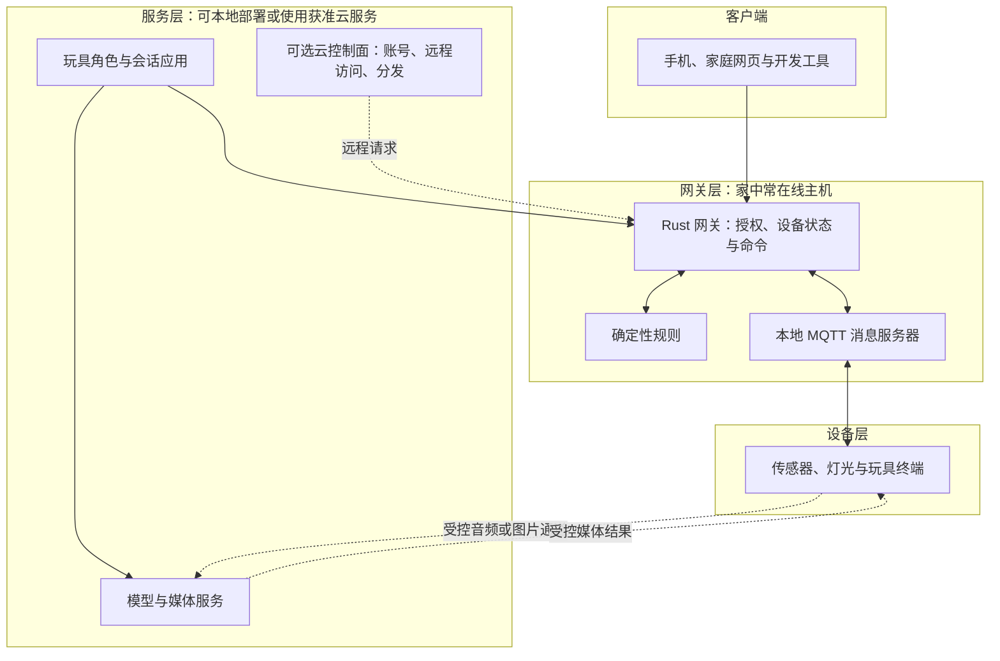
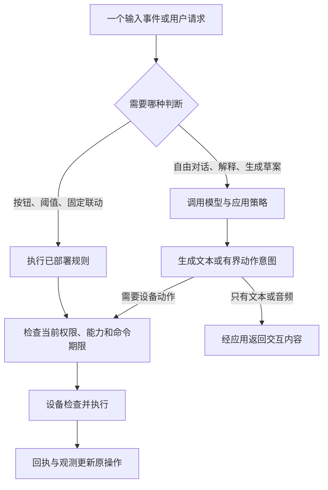

# 看懂 LimeIoT：设备、网关、服务与客户端

类型：项目架构导读。事实来源：[总体技术架构](../../03-总体技术架构.md)。本页把目标设计换成容易理解的表达；实际完成状态查询[实施进度](../../24-实施计划与进度.md)。

## 1. 四层架构各自解决什么

| 层次 | 你可以把它理解为 | 主要职责 |
| --- | --- | --- |
| 设备层 | 接触真实世界的部件 | 感知、播放、灯光、动作、本地保护 |
| 网关层 | 当前家庭或空间的设备管理与执行入口 | 协议接入、状态、授权、命令、固定规则 |
| 服务层 | 按需调用的专业服务 | 模型、媒体、内容应用，以及可选云控制面 |
| 客户端 | 人操作系统的入口 | 手机应用、本地家庭网页、开发者工具 |

下面是目标架构的简化图。实线表示业务交互，虚线表示可选或按场景使用的路径：

查看图形源码（Mermaid）

读图：设备控制在网关与设备之间完成；音视频另有媒体通道。模型生成动作意图后，要经过应用与网关的正式校验，不能直接获得设备控制权限。

图中的服务位置是部署选择。“云控制面”和“云模型”也是两种职责：一个管理远程请求、账号与制品，另一个完成推理；启用其中之一不意味着必须启用全部。

## 2. 普通规则与 AI 可以共存

查看图形源码（Mermaid）

“按下按钮就开灯”可以预先确定，交给规则更直接；“根据故事让灯模拟星光”可以由 AI 提议，再由允许的灯光动作执行。真正的电机控制、限位和急停继续留在设备本地。

## 3. 网关和模型主机可以分开

轻量网关运行设备管理和规则，不默认加载模型。算力较强的主机可以单独运行本地模型；若放在同一台机器上，也要限制模型占用的 CPU、内存和磁盘，避免影响设备控制。

本地模型能减少外部网络依赖，但小主机运行较大的模型可能比云服务更慢。位置近不等于计算快，必须按目标模型与并发测量。

## 4. 当前为什么还需要网关

现有 MVP 设计让原生设备接入家中的 MQTT 与主网关，官方云服务版也保留这个执行入口。可以复用 NAS、常开 Linux 主机或后续独立网关。云服务版不等于设备已经直接接入云端。

若目标是“用户只买一个低价玩具，家里无需任何常在线主机”，需要新增直接云接入或其他接入方案，并明确身份、会话、媒体、断网与升级策略。本教程将它列为产品选择，不冒充现有能力。

小米中枢网关适合帮助理解“多个设备共享一个家庭中枢”。这只是产品角色上的类比，不能把它当作已经能运行 LimeIoT 的主机；参见[官网分类实例](../04-场景案例/02-小米设备分类.md)。

## 5. 源码与规范怎样对照

| 想理解的部分 | 工程入口 | 深入资料 |
| --- | --- | --- |
| 设备软件 | [firmware](../../../firmware/) | [固件设计](../../08-ESP-IDF固件SDK设计.md) |
| 本地管理与执行 | [gateway](../../../gateway/) | [网关内核](../../09-Rust网关内核设计.md) |
| 正式数据与工具约定 | [contracts](../../../contracts/) | [物模型](../../05-自研物模型规范.md) |
| 家庭与手机客户端 | [apps](../../../apps/) | [客户端设计](../../15-客户端与交互设计.md) |
| 语音、模型与内容编排 | 以实施进度列出的实际实现为准 | [模型媒体](../../33-多模态模型与媒体服务.md)、[能力组合](../../32-能力组合与场景应用.md) |

目录或设计图存在，不代表其中每种能力已实现。学习时先搞懂职责，实际使用前再核对运行时与证据。

下一步：[低成本智能玩具](../04-场景案例/01-低成本智能玩具.md)或[时延与流式交互](02-时延与流式交互.md)。
