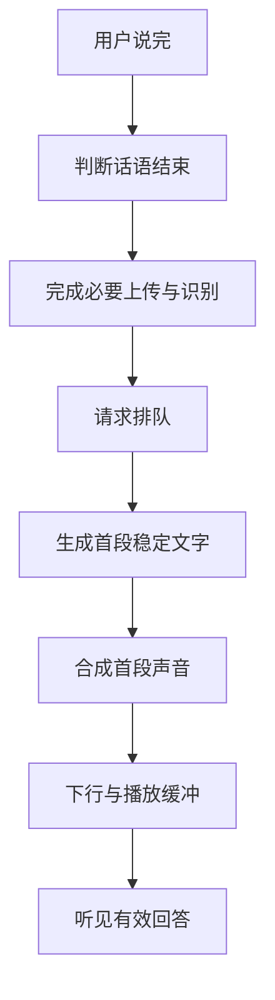
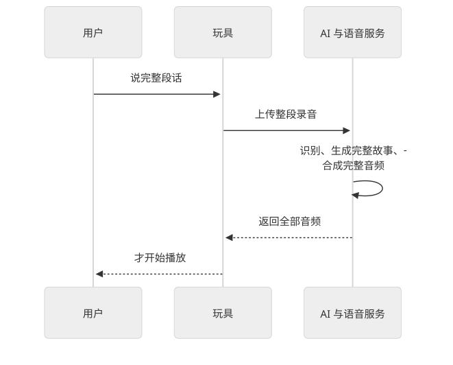
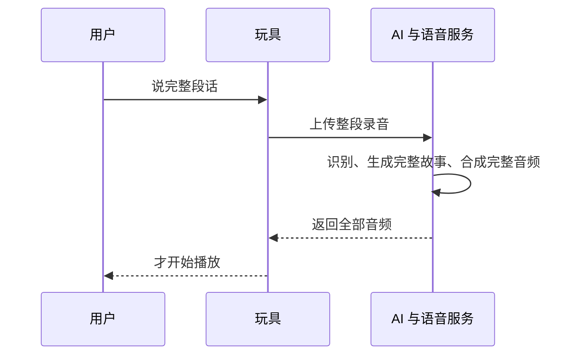
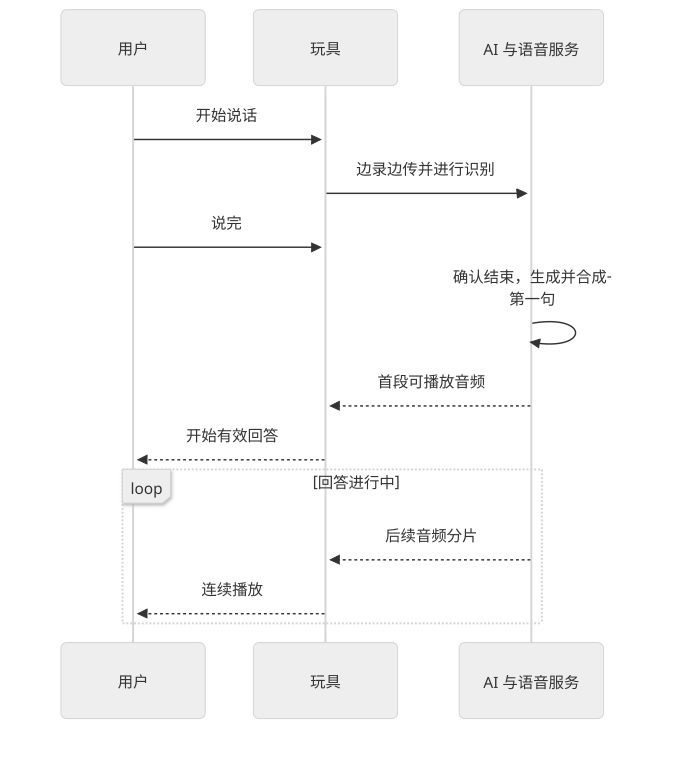
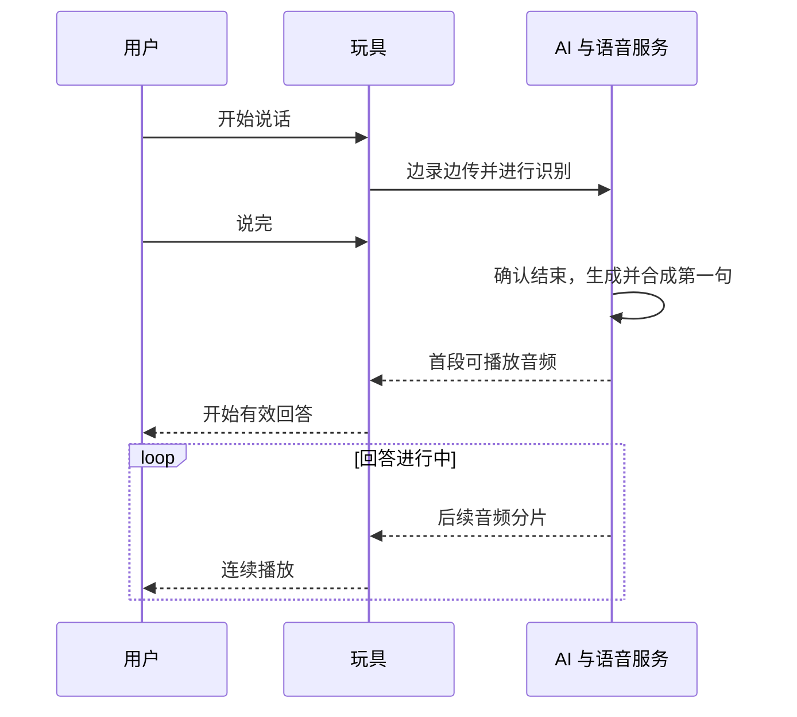
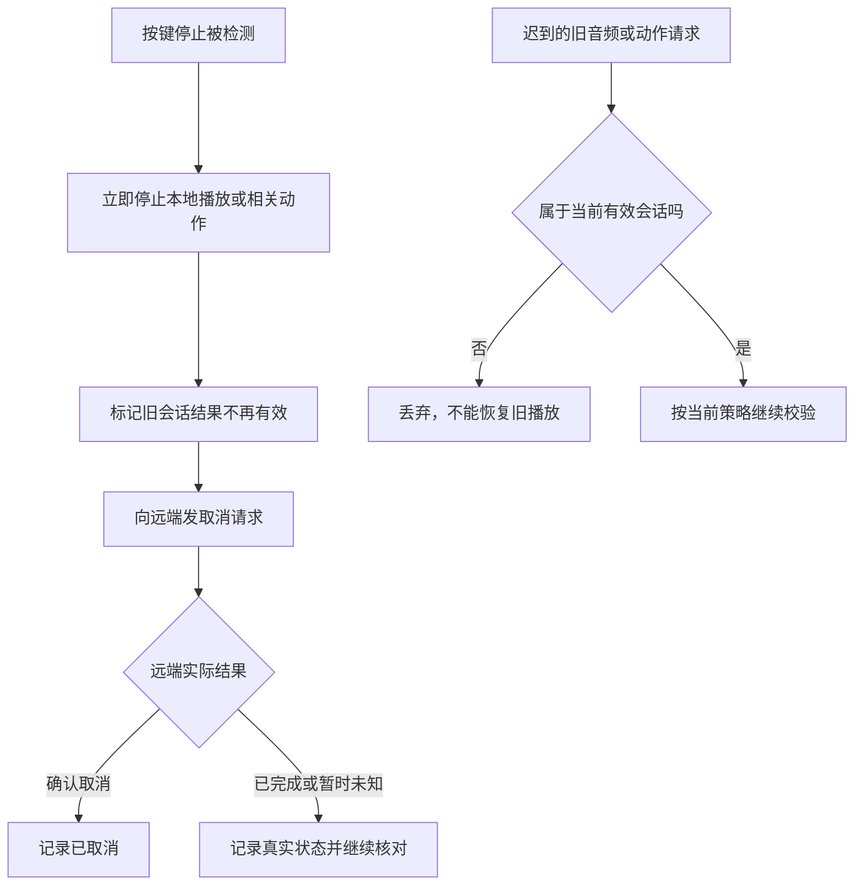

# 时延从哪里来：即时反馈、流式回答与打断

类型：交互与测量教程。本页中的示例数字用于学习，不是 LimeIoT 或小米产品的实测指标。项目测量目标唯一维护在[可靠性规范](../../28-可观测性与可靠性.md)。

## 1. 先确定从什么时候量到什么时候

| 指标 | 开始点与结束点 | 说明 |
| --- | --- | --- |
| 本地反馈时延 | 按键或触摸被检测 → 提示灯或提示音生效 | 反馈发生，不代表理解已经完成 |
| 命令受理时延 | 网关收到请求 → 可靠保存并返回原操作 | 不包含设备实际执行完成 |
| 设备控制反馈时延 | 定义好的控制起点 → 获得对应执行反馈 | 需要声明设备与测量条件 |
| 对话首段时延 | 用户实际说完 → 开始听到第一段有效回答 | 包含结束判断、网络、排队和播放准备 |
| 回答总时长 | 用户实际说完 → 整段回答结束 | 与回答长度密切相关 |
| 打断时延 | 检测到停止输入 → 本地实际停止播放或动作 | 本地停止与远端取消分别记录 |

“请求已受理”“第一声提示音”“第一段有效回答”应分别记录。否则一个立即播放的固定音效，就会掩盖真正对话等待。

## 2. 第一段回答要经过哪些环节

查看图形源码（Mermaid）

读图：每个环节都可能等待。部分工作可以提前开始、相互重叠，所以不能把所有处理总时长机械相加。缩短结束判断也有代价：容易把孩子停顿误判成说完。

## 3. 流式处理减少什么等待

串行方式等整份输入和输出准备好，再开始下一步：

查看图形源码（Mermaid）

流式方式让可确定的部分先向后流动：

查看图形源码（Mermaid）

读图：用户不用等完整故事生成。但它不会消除网络时延、模型排队或算力不足；分片太小也会增加调度开销，播放缓冲太短会容易卡顿。

流式生成与停止机制是[模型媒体设计](../../33-多模态模型与媒体服务.md)的一部分，仍需提供方、终端和应用共同实现。

## 4. 停止必须从本地开始

查看图形源码（Mermaid）

读图：用户不必等待云端确认，玩具先停播。远端是否停止计费或计算则要根据真实结果记录，不能因为本地停了就假设远端也取消成功。

语音插话还需要识别用户声音并处理扬声器回声，比按键停止复杂。可以先实现按键停止，再验证自然插话。

## 5. 怎样降低真正的等待

- 固定按钮反馈、停止与保护在设备本地处理；固定联动使用规则。
- 说话时传输并识别，确认结束后开始回答；尽早提供稳定短句。
- 在交互期间复用连接，避免每轮重新握手；按资源预算保持模型可用，减少冷加载。
- 限制回答长度、上下文和并发，监测队列；评估模型在目标硬件上的实际速度。
- 对弱网、失败和长等待提供准确反馈，并准备本地降级玩法。

## 6. 给第一次实验设一个清晰边界

可以尝试把“说完到首段有效回答约 1–2 秒”作为样机体验目标，验证能否达到；它不是现有性能承诺。目标要同时写清网络、模型版本、硬件、音频条件和并发。

p50 是一半请求达到的时延；p95 是 95% 请求达到的时延。例如大部分回答很快，少数等待十秒，平均数可能掩盖体验问题。测量时一起报告失败、超时、卡顿和取消，不能只留下成功样本。

项目文档里的本地命令受理和原生灯光反馈目标，不适用于模型对话，也尚需按指定条件实测。

自测：模型放在家里的旧电脑上，一定比云端快吗？参考答案：不一定，网络距离缩短了，但算力、加载和排队可能更慢。

返回[架构导读](01-LimeIoT架构导读.md)或进入[智能玩具](../04-场景案例/01-低成本智能玩具.md)。
