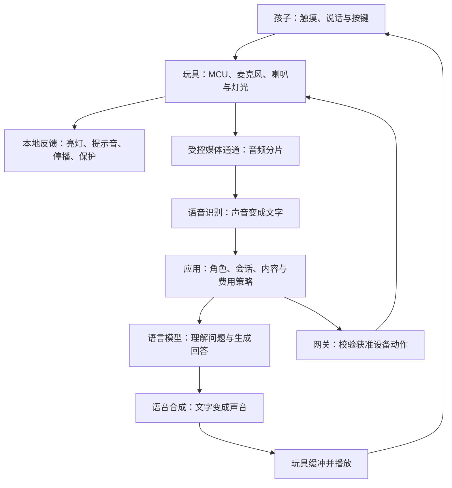
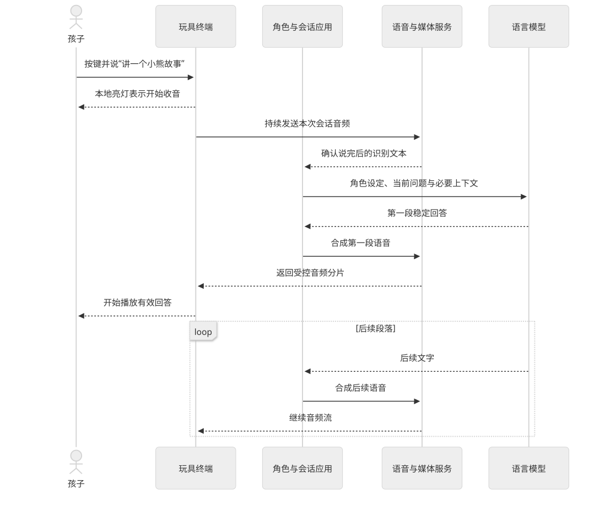
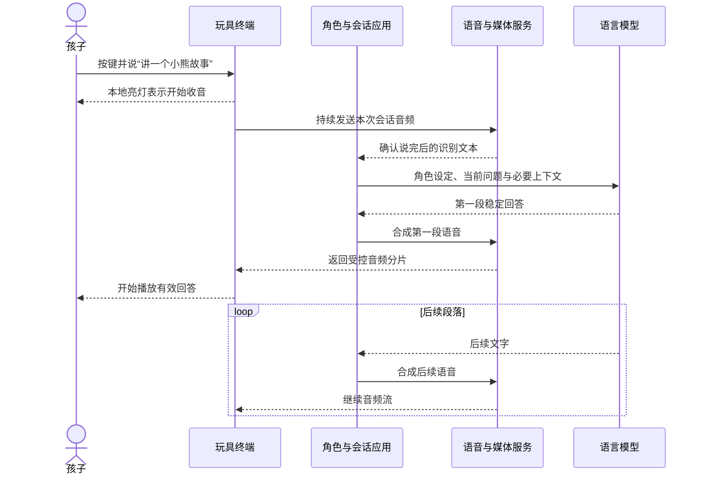

# 低成本玩具怎样拥有智能

类型：产品方案图解。场景为能听、能说、能亮灯的玩具。依据：[能力组合](../../32-能力组合与场景应用.md)、[模型与媒体服务](../../33-多模态模型与媒体服务.md)。语音样板属于规划能力，实际进度见[24](../../24-实施计划与进度.md)。

## 1. 先定义足够智能是什么

第一版可以明确四件事：按键开始对话、理解常见问题、按角色讲故事、配合灯光反馈。是否需要识图、走动、远场唤醒与随时插话，要分别评估硬件、软件与费用。

角色设定、回答长度、故事内容、有限会话记忆和稳定反馈都会影响体验。增加模型参数或芯片性能，并不自动解决这些产品问题。

## 2. 把计算放到合适的位置

查看图形源码（Mermaid）

读图：录音与播放在玩具，识别与生成由共享服务承担。图省略了传输代理等实现细节；提供方密钥与不受限的设备权限不交给玩具或模型。

当前架构的网关仍承担家庭设备入口；媒体与模型的部署位置可按允许的本地或云端方案选择。

## 3. 一次对话的时序

查看图形源码（Mermaid）

这是教学目标流程，不是已运行的产品接口。语音输入的临时识别结果可能修订，不能因为听到半句话就执行高后果动作。

## 4. 第一版硬件怎样取舍

| 功能 | 第一版建议 | 增加复杂度的原因 |
| --- | --- | --- |
| 开始对话 | 按键或触摸触发 | 远场唤醒还要考虑持续监听、误唤醒、功耗与声学 |
| 说话反馈 | 喇叭与简单灯光 | 屏幕增加显示、交互和电源工作 |
| 对话模式 | 先按键说话、分轮回答 | 同时说和听需要处理回声、插话与取消竞态 |
| 内容 | 固定角色、简短对话与少量本地故事 | 无限长聊增加模型用量、等待和内容管理负担 |
| 摄像头和运动 | 有明确玩法时再加入 | 图像带宽、隐私、机械控制和保护要独立验证 |

项目的[硬件方案](../../19-硬件选型采购与BOM.md)把 ESP32-S3 音频开发板、I2S 麦克风、功放和喇叭列为后续候选。它是实验选型线索，尚不是冻结的量产玩具 BOM，不能把已有灯光套件预算当成语音玩具报价。

## 5. 云故障时仍然能做什么

玩具可以按产品配置保留本地招呼、已下载故事、触摸小游戏、停止播放和必要保护。开放式聊天需要模型服务，无法在低成本终端上保证与在线时完全相同。

媒体上传、儿童会话、长期记忆和服务费用需要明确的产品政策。本地与云端提供方的切换也要遵循获准的数据范围。

## 6. 用小米产品理解组成部分

温湿度计帮助理解轻量感知，智能音箱帮助理解麦克风、扬声器和网络协作，家庭中枢帮助理解共享设备管理。它们是学习参照，不能由官网外观判断模型在哪里运行，也不能据此推断厂商成本。证据见[小米设备分类](02-小米设备分类.md)。

自测：玩具说出预先保存的“我在听”，是否证明模型已经理解了孩子？参考答案：只证明本地反馈发生了；真正回答的首段时延要单独测量。

继续阅读：[时延与流式交互](../03-架构与方法/02-时延与流式交互.md)、[成本、离线与安全](../05-成本与可靠性/01-成本离线与安全.md)。
