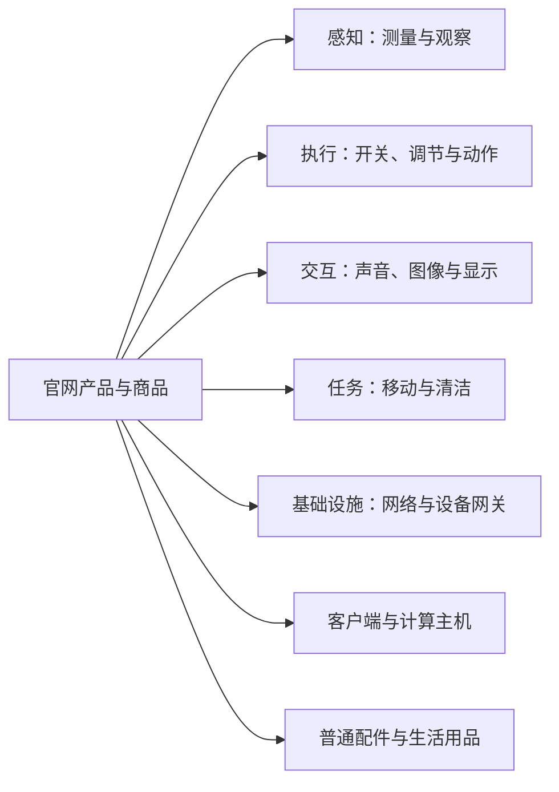

# 从小米官网认识设备：销售分类与技术职责

类型：官网资料整理与教学案例。观察日期：2026-11-01。方法：使用 Computer Use 在 Chrome 浏览小米官网、商城分类、商品列表、代表商品详情与音箱参数页。

本页记录公开网页中实际看到的信息，不是全部在售型号清单。下文技术分类由本教程整理；具体协议、开放接口、离线能力和第三方支持不能仅凭商品归类得出。LimeIoT 型号支持仍查询[证据台账](../../30-设备支持矩阵与证据台账.md)。

## 1. 官网按销售场景划分的十个大类

依据：[小米商城全部商品分类](https://www.mi.com/shop/category/list)。各行仅摘录与学习有关的代表内容。

| 官网一级分类 | 本次页面中观察到的内容 | 可以学习什么 |
| --- | --- | --- |
| 手机 | Xiaomi、REDMI 多系列 | 用户操作入口；部分产品也承担感知和计算 |
| 电视 | 多种电视系列 | 显示、媒体与联网终端 |
| 家电 | 空调、冰箱、净水器、扫地机器人、加湿器、灯具等 | 传感、执行、反馈与本地控制 |
| 笔记本 平板 显示器 | 笔记本、平板、显示器 | 客户端与计算主机的区别；外设不必然独立联网 |
| 出行 穿戴 | 手环、手表、AI 眼镜等 | 电池设备、功耗与持续感知 |
| 耳机 音箱 | 耳机、蓝牙音箱、智能音箱、家庭屏 | 音频、语音交互与多种连接用途 |
| 健康 儿童 | 体重秤、体脂秤、跑步机、儿童手表、益智积木等 | 感知、运动和场景应用；逐型号确认是否联网 |
| 生活 箱包 | 背包、旅行箱、服饰、工具、水杯等 | 普通商品也会出现在同一商城 |
| 智能 路由器 | 路由器、智能家庭、摄像机、门锁、门铃、音箱等 | 网络、设备接入、媒体和家庭入口 |
| 电源 配件 | 插座插排、移动电源、充电器、电池、线材等 | 供电基础与智能开关的区别 |

不要把销售类别直接当成技术类别。例如“智能 路由器”下面的路由器、摄像机和门锁职责不同；“电源 配件”下面也同时存在普通配件与具备联网能力的产品。

## 2. 换成技术视角重新分类

查看图形源码（Mermaid）

读图：这是按职责重新建立的学习地图。一台扫地机器人同时有感知、执行和任务能力；音箱也可能集成其他角色，应根据型号证据给它增加标签。

| 教学分类 | 官网可找到的代表设备或品类 | 对应基础章节 | 还要核对什么 |
| --- | --- | --- | --- |
| 环境感知 | 米家智能温湿度计3、蓝牙温湿度计2 | [设备与硬件](../01-基础入门/01-设备与硬件.md) | 上报方式、网关依赖、采样与供电 |
| 人体与活动感知 | 体重秤、体脂秤、手环、手表 | [设备与硬件](../01-基础入门/01-设备与硬件.md) | 实际测量项目、数据含义和授权；不自动视为医学结论 |
| 开关与环境执行 | 米家智能插座3、小米智能插座4、灯具、风扇、空调等 | [连接与消息](../01-基础入门/02-连接协议与消息.md) | 准确型号是否联网、执行范围、反馈与停止 |
| 音视频交互 | Xiaomi 智能音箱 Pro、家庭屏、智能摄像机、电视 | [智能玩具](01-低成本智能玩具.md)、[时延](../03-架构与方法/02-时延与流式交互.md) | 媒体通道、带宽、播放控制及数据访问 |
| 移动与长任务 | 扫地机器人 | [架构导读](../03-架构与方法/01-LimeIoT架构导读.md) | 任务开始、暂停、完成、避障与设备本地控制 |
| 设备网关 | 小米中枢网关 | [标准与生态](../02-标准与生态/01-标准协议与生态边界.md) | 可接入协议、设备范围、本地执行与实际开放条件 |
| 网络基础设施 | 小米路由器、REDMI 路由器 | [连接与消息](../01-基础入门/02-连接协议与消息.md) | 网络覆盖、频段、接入容量；是否另有设备网关功能 |
| 客户端与计算主机 | 手机、平板、笔记本 | [架构导读](../03-架构与方法/01-LimeIoT架构导读.md) | 产品承担什么软件角色，是否适合常在线运行 |
| 普通商品 | 箱包、线材、部分插排和生活用品 | [入门十问](../00-高频问题/01-入门十问.md) | 是否真的具有通信、计算或受控执行能力 |

同一行出现的型号与品类仅表示教学角色相似，不能据此推断互相兼容、采用相同芯片或拥有相同协议。

## 3. 已核对的代表资料

| 编号 | 官网来源与证据层次 | 本次能确认的信息 | 本次不能据此确认的信息 |
| --- | --- | --- | --- |
| XM-01 | [全部商品分类](https://www.mi.com/shop/category/list)，目录 | 上述十个一级类别和代表子项 | 各子项每个型号的联网与支持情况 |
| XM-02 | [温湿度计列表](https://www.mi.com/shop/search?keyword=%E6%B8%A9%E6%B9%BF%E5%BA%A6%E8%AE%A1)，商品卡片 | 温湿度计3、3 mini、3 Pro、蓝牙温湿度计2等名称 | 不同代产品的协议、精度和网关条件相同 |
| XM-03 | [米家智能温湿度计3详情](https://www.mi.com/shop/buy/detail?product_id=18084)，文字与详情图 | 页面说明温湿度测量、大尺寸 LCD、舒适提醒等功能 | 本次未完成蓝牙版本、广播格式、第三方接口核对 |
| XM-04 | [小米中枢网关详情](https://www.mi.com/shop/buy/detail?product_id=15755)，文字与详情图 | 页面描述四核处理器、蓝牙信号放大器；详情图说明内置小米 Mesh 2.0 网关并提及蓝牙与蓝牙 Mesh 设备 | 未据此确认 Zigbee、Matter、第三方 API、全部离线能力或 LimeIoT 兼容 |
| XM-05 | [Xiaomi 智能音箱 Pro 参数](https://www.mi.com/xiaomi-smart-speaker-pro/specs)，正式参数页 | 环形麦克风阵列、扬声器、灯带；蓝牙5.0支持A2DP音乐播放；2.4/5GHz Wi-Fi；Type-C音频连接；禁麦按键 | 参数页没有证明大模型部署位置、实测对话时延或全部网关协议 |
| XM-06 | [智能插座列表](https://www.mi.com/shop/search?keyword=%E6%99%BA%E8%83%BD%E6%8F%92%E5%BA%A7)，商品卡片 | 米家智能插座3、小米智能插座4等型号存在于结果中 | 本次未逐项核对通信、负载、电量统计与开放接口 |
| XM-07 | [摄像机列表](https://www.mi.com/shop/search?keyword=%E6%91%84%E5%83%8F%E6%9C%BA)，商品卡片 | 多种室内外型号；包括明确以4G命名的室外型号及摄像机云存套餐 | 不能把全部摄像机归为Wi-Fi，也不能推断视频接口对第三方开放 |

商品页可能按地区、登录、活动和时间变化，本页不把动态价格作为永久事实。参数页比商品名称能支持更多具体技术判断；用户评价或营销词也不能代替实机验证。

## 4. 三个读官网的练习

**练习一：看到智能音箱的“蓝牙5.0、A2DP”能得出什么？**

可以确认该参数页描述了蓝牙音乐播放能力。要判断是否能接入低功耗传感器或管理蓝牙 Mesh，需要另外的型号证据。

**练习二：看到中枢网关“四核处理器”，能推断可以本地跑大模型吗？**

不能。还需知道架构、内存、软件、模型、资源预算和性能。处理器核心数不是模型体验证明。

**练习三：一个温湿度计和一个风扇，就能保证跨品牌联动吗？**

需要它们各自有可用的接入路径、对应授权、正确的数据与动作映射，以及真正运行规则的地方。先画清路径，再判断缺什么。

## 5. 怎样继续扩充资料

下一步按场景挑型号，使用[资料收集模板](../06-资料与工具/资料收集模板.md)记录“官网说明、技术归类、待核对项、实际验证”四类内容。新增一台具体设备的支持结论，应进入正式证据台账，而不是只在教学表里加一个勾。

返回[知识库首页](../README.md)。
