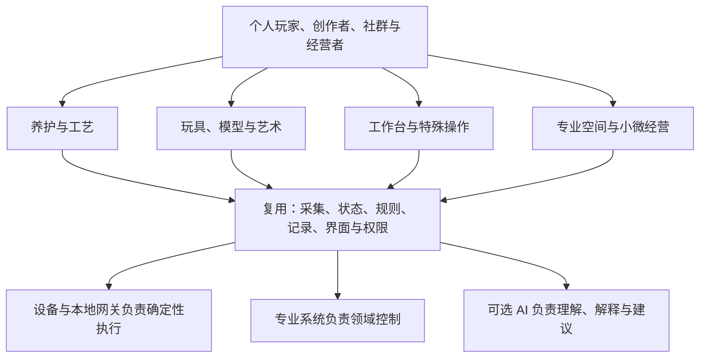

# 长尾场景机会地图：个人定制、小众爱好与专业玩家

LimeIoT 值得研究的方向，是让个人、社群和小型经营者把不同设备组合成自己的系统：按自己的环境采集数据，按自己的玩法联动，保存和分享配置，并在需要时调用 AI。

这里把**个人定制、小众爱好、深度玩家**作为核心用户，与商业定制并列。长尾不是只给小企业做项目，也不意味着需求价值低。一个人可能只有一套设备，却非常在意精度、可改性、隐私、离线运行和多年维护。

本篇整理 **32 类、160 个候选细分需求**，用于发现和学习，不是近期功能清单。来源及其限制见[研究台账](../06-资料与工具/03-长尾场景研究来源.md)，定制如何落到架构见[用户定制与平台能力](04-用户定制与平台能力.md)。

## 1. 怎样理解“大公司标准产品难覆盖”

不能直接判断某家公司“不屑于做”。更有用的是看需求为什么难以变成一个统一商品：

| 难标准化的原因 | 具体例子 | 可能的机会 |
| --- | --- | --- |
| 设备组合不同 | 两个海缸的水泵、灯、探头和缸体不同 | 适配与配置复用 |
| 参数与流程不同 | 同一咖啡机，玩家的豆子、曲线和实验目标不同 | 参数版本、历史对比、玩法模板 |
| 场地条件不同 | 旧厂房、老建筑、户外点位不能随意布线 | 多种接入与渐进改造 |
| 交互方式不同 | 大按钮、脚踏开关、语音、无屏幕操作 | 输入重映射与专用界面 |
| 安装维护占比高 | 小门店设备少，但现场排障仍需专业人员 | 限定支持范围的套件与本地服务伙伴 |
| 用户追求改装乐趣 | 自制外壳、灯效、模型布局和机器人附件 | 可扩展接口、教程和社群配方 |

这些方向已经存在专业厂商、开源项目和集成商。机会需要通过**降低哪一步的成本**来证明，例如减少一次配线、一次配置、一次排障，或者把成熟方案带给原来不会搭建的人。

## 2. 使用者、创作者和付费方分别是谁

| 人群 | 最想得到什么 | 可能的付费方式，均待验证 |
| --- | --- | --- |
| 有具体需求的新手 | 买齐能用，按向导完成安装 | 套件、安装、售后 |
| 深度玩家 | 能改参数、接新设备、看数据、保持本地可用 | 选配硬件、专业扩展、便利服务；未必接受订阅 |
| 创客与方案作者 | 自制设备可交付，配置可复用 | 开发/测试工具、分发服务；分成机制需另行设计 |
| 社群与工作室 | 多人协作，复制一套成熟玩法 | 培训、课程、活动和维护 |
| 小微经营者 | 少巡检、少损失、少停机 | 项目交付、维护、持续监测；需明确责任与响应方式 |
| 小批量设备厂商 | 同一硬件可按客户配置 | 接入、批量部署与设备生命周期服务 |

## 3. 生物养护、种植与饮食实验

下列每行列出五个细分需求。**“已见依据”只覆盖该列明确写出的部分**；其余条目是待核验设想。来源编号对应[研究台账](../06-资料与工具/03-长尾场景研究来源.md)。全部 LimeIoT 切入点都属于产品假设。

| 编号与方向 | 五个候选细分需求 | 使用者／可能付费方 | 用户真正想定制什么 | 已见依据与缺口 |
| --- | --- | --- | --- | --- |
| 01 水族与海缸 | 水温监控；自动补水；昼夜灯光；滴定排程；pH 趋势 | 鱼友、海缸玩家／本人、维护工作室 | 每个缸的设备、探头校准、养护日程 | S01 覆盖这五类功能；LimeIoT 适配与需求优先级待验证 |
| 02 爬宠与生态缸 | 昼夜温区；湿度周期；雾化排程；照明周期；多缸巡检 | 爬宠、昆虫、两栖玩家／本人、繁育者 | 物种、季节、缸体位置和多探头规则 | S13 列出生态缸用途与环境控制；具体物种方案待核验 |
| 03 珍稀植物与家庭种植 | 兰花分区浇水；多肉补光；食虫植物水位；水培指标记录；育苗环境 | 植物玩家／本人、苗圃 | 植物分组、日照、基质、不同阶段参数 | S06 支持分区灌溉，S12/S13 有种植和水培用途；具体植物方案待核验 |
| 04 宠物的个性化照护 | 饮水余量；喂食记录；多宠识别；远程互动；异常活动提醒 | 宠物主人／本人 | 个体作息、饮食计划、家庭成员权限 | 本轮未核验专门案例；识别准确性与照护效果待研究 |
| 05 食用菌与微型培养 | 培养箱温湿度；换气排程；光照周期；批次曲线；污染观察记录 | 蘑菇玩家、实验爱好者／本人、小农户 | 培养阶段、箱体、批次和记录方式 | S13 源于食用菌培养；污染识别等能力未核验 |
| 06 自酿与发酵 | 发酵温控；比重采集；发酵曲线；分批对比；异常停滞提醒 | 自酿、酸面团、康普茶玩家／本人、工作室 | 配方、校准、批次、温度阶段 | S02 有比重/温度采集，S13 列发酵用途；停滞识别与食品安全未验证 |
| 07 咖啡与茶工作台 | 萃取曲线记录；称重联动；配方版本；清洁提醒；补水状态 | 咖啡、手冲、茶玩家／本人、小工作室 | 曲线、设备组合、实验笔记与对比 | S09 有曲线、称重、历史和共享；茶工作流与外围联动待核验 |
| 08 烘焙与食品工艺 | 醒发环境；烘焙温度记录；奶酪熟成；风干环境；分阶段计时 | 家庭实验者、手作食品者／本人、工作室 | 工艺步骤、设备探头、过程留档 | S13 列奶酪、熟成、烹饪用途；具体工艺与食品安全不由平台保证 |

这些场景常共享“温湿度＋时间＋开关＋记录”，但不能共用一组默认参数。海缸补水、菌菇换气和醒发箱加热的故障后果不同，专业参数应由相应领域的人确定。

## 4. 玩具、模型与创意体验

| 编号与方向 | 五个候选细分需求 | 使用者／可能付费方 | 用户真正想定制什么 | 已见依据与缺口 |
| --- | --- | --- | --- | --- |
| 09 个性玩具与陪伴物 | 自定义角色；语音故事；触摸反馈；积木机关；多人剧情 | 玩具玩家、亲子创客／家庭、小批量作者 | 角色、内容、动作、外壳和交互规则 | 可参考现有[玩具教学案例](01-低成本智能玩具.md)；本轮未核验整机商业案例，完整媒体/模型链路仍需实施 |
| 10 灯光、Cosplay 与节日布置 | 灯带分区；服装灯效；音乐联动；节日排程；多装置场景 | 灯光、Cosplay 玩家／本人、活动方 | 灯珠布局、效果、触发方式、演出顺序 | S05 支持分段、预设、多接口；服装、音乐、同步体验需单独验证 |
| 11 模型铁路与沙盘 | 道岔控制；信号灯；轨道占用显示；建筑灯光；展览运行脚本 | 铁路、沙盘玩家／本人、俱乐部 | 线路拓扑、车辆、附件、布局和剧本 | S04 有道岔、附件、动画及俱乐部自动化；占用采集的具体方案待核验 |
| 12 遥控模型与桌面机器人 | 电池遥测；运行记录；附件控制；固定场地状态；维修提醒 | 模型车船、机器人玩家／本人、社群 | 附件映射、仪表、不同模型参数 | 本轮未核验专门案例；遥控、姿态和电机闭环保留在专用控制系统 |
| 13 模拟驾驶、飞行与游戏桌 | 自制按钮盒；仪表显示；状态灯；触觉外设场景；桌面设备联动 | 模拟器、赛车和游戏玩家／本人、体验馆 | 按键映射、界面、外设组合、游戏事件 | 本轮未核验专门案例；游戏接口、反作弊约束与同步需另查 |
| 14 音乐与互动艺术 | MIDI 触发装置；传感器乐器；展品触摸反馈；排练状态；空间音画联动 | 艺术家、乐手／本人、展陈方 | 传感器到音画的映射与场景 | S05 证明灯光有外部控制接口；MIDI、音频同步和具体装置待核验 |
| 15 天文与私人观测站 | 设备状态；天气采集；电源管理；调焦状态；穹顶联动 | 天文玩家／本人、俱乐部 | 设备组合、观测流程、气象条件和授权 | S03 有上述设备类别；自动防雨、开合及可靠性需专业验证 |
| 16 摄影与自然观察 | 延时拍摄；相机箱环境；鸟类观察记录；远程电量；拍摄条件触发 | 摄影、观鸟玩家／本人、社群 | 触发条件、存储策略、地点和观察记录 | S13 有摄像头、延时摄影；鸟类识别和野外续航待核验 |

这组需求的价值还包括表达、创作和折腾的乐趣。“省几分钟”不是唯一购买理由。可以研究把设备搭建过程、外壳文件、配置和成品效果组织成可复用的玩法包。

## 5. 个人工作台、特殊操作与社群

| 编号与方向 | 五个候选细分需求 | 使用者／可能付费方 | 用户真正想定制什么 | 已见依据与缺口 |
| --- | --- | --- | --- | --- |
| 17 Homelab 与家庭机柜 | UPS 状态；机柜温湿度；漏水检测；功耗记录；停电处置联动 | NAS、服务器玩家／本人、小工作室 | 设备依赖、告警方式、停机顺序 | S14 有电源协议与监控管理；具体关机流程和外围适配需验证 |
| 18 3D 打印、激光与 CNC 工作台 | 耗材箱湿度；打印状态；通风状态；任务完成灯；工位使用记录 | 制造玩家／本人、创客空间 | 机器与外围设备组合、耗材和工位规则 | S07 有打印状态和事件钩子；激光/CNC 方案待核验，急停与运动控制不交给平台 |
| 19 收藏与特殊储存 | 乐器湿度；茶叶环境；雪茄柜记录；胶片保存；模型展示柜 | 收藏玩家／本人、工作室 | 按藏品划分区域、阈值和保养记录 | S15 是文物环境监测案例；个人藏品的适宜条件、价格和需求待核验 |
| 20 无障碍与个性化操作 | 大按钮控制；脚踏输入；触摸替代；语音辅助；适配玩具接口 | 有特殊操作需要的人／本人、家庭、服务组织 | 可触达位置、力度、输入方式、确认反馈 | S10 有辅助设备、适配游戏和改造玩具；并非所有方案联网，个体适配需共同设计 |
| 21 露营、房车与小船 | 水箱余量；电池状态；车舱环境；储物箱状态；弱网告警缓存 | 户外、房车、航行玩家／本人、改装方 | 移动场景、能源预算、离线方式 | 本轮未核验专门案例；网络、功耗、防护、定位与地区要求待调查 |
| 22 运动与训练 | 反应灯；分段计时；器材计数；训练反馈；个体计划提醒 | 运动玩家、教练／本人、工作室 | 训练项目、触发方式、个人记录 | 本轮未核验专门案例；测量误差和专业训练效果需独立评估 |
| 23 教育与公民科学 | 学生气象站；植物实验；土壤观察；实验数据看板；班级装置互动 | 学校、家长、社群／学校、机构、家庭 | 课程、传感器、学生权限和数据展示 | S12 有教育/种植案例，S08 有 MCU 模块化入口；具体课程效果未研究 |
| 24 社群与共享空间 | 工具借用状态；工位预约显示；活动按钮；共享环境看板；值班巡检 | 创客空间、俱乐部／组织方、会员 | 成员角色、使用流程、设备与活动规则 | 本轮未核验专门案例；门禁、计费和人员管理不能从普通开关直接扩展 |

无障碍的个体差异与小众爱好的差异性质不同，应尊重使用者自己的目标，不能把它当作统一模板套用。共同点在于：用户需要能按自身情况调整系统。

## 6. 小微经营与专业定制

| 编号与方向 | 五个候选细分需求 | 使用者／可能付费方 | 用户真正想定制什么 | 已见依据与缺口 |
| --- | --- | --- | --- | --- |
| 25 微型农业与养殖 | 蜂箱环境；苗圃灌溉；蘑菇房巡检；小型水产监测；畜舍供水状态 | 小农户、合作组织／经营者 | 点位、品种、网络、季节、巡检路线 | S06 有农场灌溉，S13 列蜂箱、蘑菇和水生系统用途；单点经济性待验证 |
| 26 餐饮、烘焙与小零售 | 冷柜超温；热柜记录；设备断电；开门频次；值班通知 | 店主、员工／店主、维护商 | 老旧设备、营业时间、人员轮班和告警 | S16 有冷/热柜集中监测；单店不是原案例规模，开门与断电需求待核验 |
| 27 宠物店、水族店与繁育室 | 多缸状态；分区环境；设备离线；养护记录；异常分级通知 | 店员、维护者／店主、繁育者 | 从“一个缸”到“几十个对象”的分组与交接 | S01/S13 支撑部分养护技术；门店经营流程与付费待访谈 |
| 28 民宿、营地与小场馆 | 空房设备状态；漏水告警；室外照明；水箱巡检；维修工单触发 | 经营者、维护者／场所业主 | 不同房型、季节、空间和服务流程 | 本轮未读专门详情案例；访客权限、入住系统和远程服务需另查 |
| 29 老旧设备与小工厂 | 运行电流；振动采样；计数采集；停机记录；维护提醒 | 维修人员、生产管理者／企业、设备商 | 设备年代、采集位置、班次、阈值 | 本轮未核验专门案例；工业可靠性、校准和控制系统边界需专业评估 |
| 30 分散水务与基础设施 | 水位采集；漏水点位；泵状态；流量记录；井盖状态 | 物业、农场、维护队／设施业主 | 分散点位、低功耗、弱网、巡检分工 | S06 有泵/阀编排；分散设施实地环境与收益待核验 |
| 31 设备租赁与流动资产 | 租出状态；累计使用时长；电池健康；交还检查；保养记录 | 出租方、活动服务商／经营者 | 不同型号、租期、责任人和生命周期 | 本轮未核验专门案例；资产位置、数据授权与商业流程需另查 |
| 32 小型文博、档案与专业库房 | 展柜温湿度；库房漏水；冷柜环境；分区趋势；巡检处置记录 | 管理员、保管员／机构、工作室 | 藏品类别、空间、告警级别和记录要求 | S15 有实际部署；小机构采购、校准要求、服务承诺和预算待验证 |

## 7. 从这些场景中提取可复用能力

查看图形源码（Mermaid）

| 共用需求 | 跨场景例子 | 需要保留的差异 |
| --- | --- | --- |
| 环境曲线与阈值 | 生态缸、耗材箱、藏品柜、冷柜 | 单位、校准、采样频率、允许偏差与处置方式 |
| 时间与分阶段流程 | 灯效、发酵、育苗、展览脚本 | 时间精度、断电恢复、暂停与人工接管 |
| 组合输入输出 | 按钮触发玩具、脚踏触发灯光、门磁触发提醒 | 动作权限、持续时间、反馈与取消 |
| 专业系统连接 | INDI、DCC-EX、OctoPrint、NUT | 各自的术语、鉴权、版本与控制边界 |
| 配置分享与迁移 | 灯光玩法、种植方案、工作台配方 | 设备映射、软件版本、参数重校准与责任归属 |
| 运维与协作 | 社群工位、门店、工作室 | 所属空间、值班者、变更记录和响应服务 |

“平台复用”应复用这些稳定能力，而不是把所有行业字段都塞进一个巨大设备类型。也不应为了支持表格里的每个方向立即实现一套行业系统。

## 8. 哪些方向值得先验证

下表是基于本轮资料和架构边界的**定性建议**，不是市场排名。优先验证差异化是否成立，再决定投入。

| 候选样板 | 先交付什么最小价值 | 为什么有助于验证平台 | 主要疑点 |
| --- | --- | --- | --- |
| 个性灯光与桌面互动 | 一个按钮触发多设备预设，用户可保存和迁移玩法 | 容易观察反馈，可验证设备绑定、编排、界面与模板 | WLED/HA 已很成熟，必须证明操作更省事或新用户更容易完成 |
| 个人养护空间 | 同一界面查看多个温湿度/水位点，记录异常和养护动作 | 验证数据模型、记录、分组、离线和提醒 | 生物养护参数、传感器维护、误报与售后成本 |
| 玩家工作台 | 接入已有打印/电源系统，统一外围状态和完成提示 | 验证已有生态连接的增量价值 | 用户是否只需现有插件，是否会为统一体验付费 |
| 智能玩具与互动角色 | 一种硬件、一种角色、一条可测的对话/动作链路 | 验证 AI 与真实设备组合的体验 | 语音时延、模型费用、内容、隐私和小批量硬件交付，开发负担更高 |
| 小店冷柜或专业储物空间 | 先做可追溯监测与值班提醒 | 验证经营者是否因减少损失而持续付费 | 现场交付、校准、通信、告警可靠性与响应责任 |

建议先选择前三项中的**一个主样板和一个复用样板**，检验同一组能力是否真的能跨场景工作。智能玩具保留独立验证线，按[低成本玩具](01-低成本智能玩具.md)和[时延](../03-架构与方法/02-时延与流式交互.md)中的方法测量，不把所有长尾需求都变成语音聊天设备。

## 9. 怎么确认不是“看起来有趣，但做不成业务”

每个候选方向先记录同一组证据：

1. **看真实流程**：用户现有设备、每周操作、发生过的故障和手工补救；不用只有“你觉得好不好”的问卷。
2. **对照现有方案**：现成商品、HA/ESPHome、专业开源工具、人工巡查；写清 LimeIoT 具体少了哪一步。
3. **做窄样板**：限定型号和安装条件，让用户自己完成一次配置与恢复；记录完成时间和求助次数。
4. **确认付费对象**：愿意买硬件、愿意付安装费与愿意订阅是三件事，分别问、分别验证。
5. **算完整成本**：硬件＋网关分摊＋安装＋网络/模型＋校准维护＋售后＋退换，不能只看 MCU 价格。
6. **观察复用**：第二个用户能否沿用方案，第二个领域能否沿用核心能力；每次都重写则更像项目服务。

长期可研究“开源底座＋玩法与设备生态＋有边界的交付服务”。硬件套件、专业插件、模板服务、远程便利服务和商业维护均是待验证收入选项，不应把本地基础控制能否继续运行绑在不可预测的模型调用上。

下一篇：[用户定制与平台能力](04-用户定制与平台能力.md)。返回[知识库首页](../README.md)。
