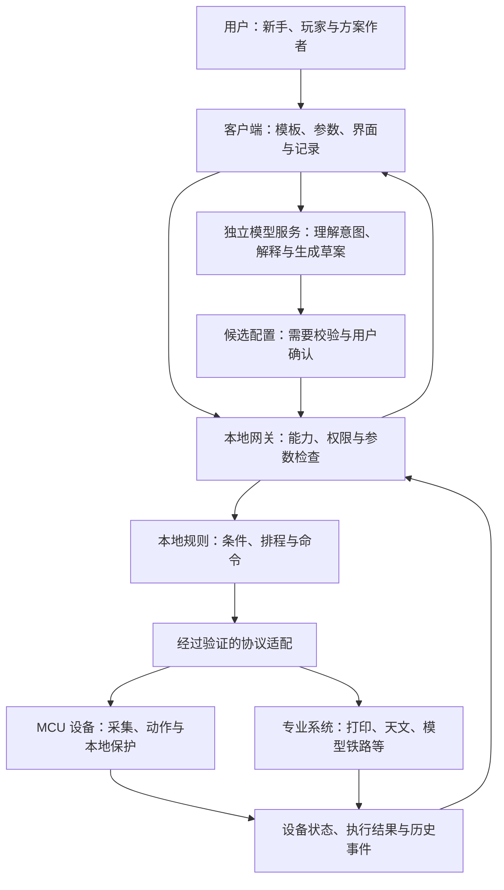
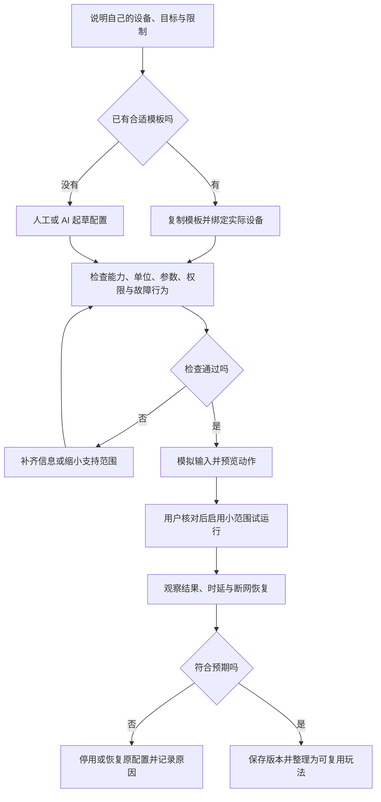
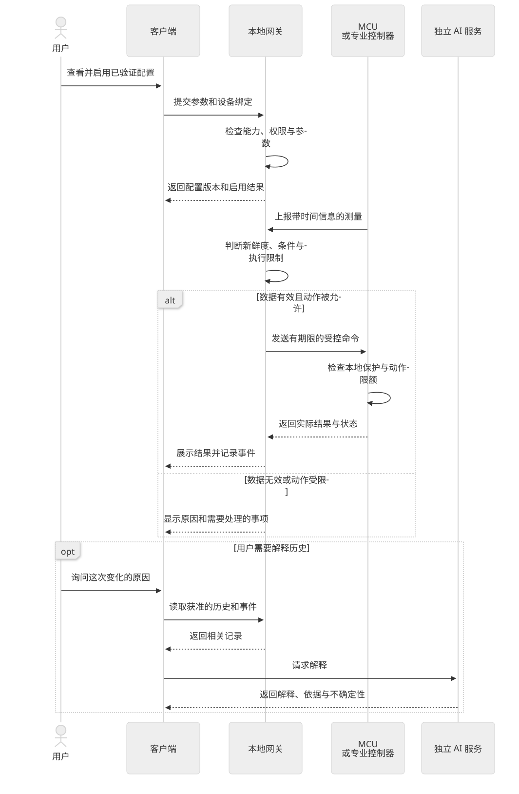
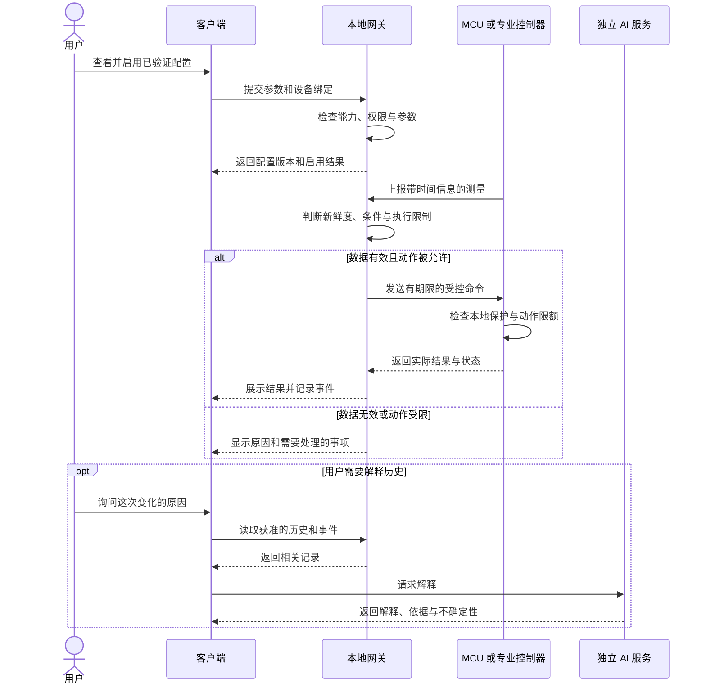

# 用户定制与平台能力

“用户可定制”不应只意味着用户能写代码。新手应该能选模板、绑定设备、改几个参数；深度玩家应该能组合规则、保存版本、连接专业工具；开发者可以制作设备适配和玩法包。三个入口可以共用同一套设备、状态、权限和执行机制。

本篇是[长尾场景机会地图](03-长尾场景机会地图.md)的教学延伸，说明一种可研究的产品组织方式。它不新增正式需求承诺，也不宣称下面所有能力已经交付。架构以[总体架构](../../03-总体技术架构.md)为准，实现进度以[实施计划](../../24-实施计划与进度.md)为准，设备兼容以[证据台账](../../30-设备支持矩阵与证据台账.md)为准。

## 1. 用户究竟可以改什么

| 定制维度 | 新手可以做什么 | 玩家或开发者进一步做什么 | 例子 |
| --- | --- | --- | --- |
| 硬件组合 | 将已支持设备绑定到模板里的位置 | 开发适配器、自制 MCU 节点和附件 | 同一种养护模板换用不同温度探头 |
| 参数 | 改时间、亮度和阈值 | 校准、分阶段曲线、多变量约束 | 白天和夜晚采用不同设定 |
| 自动化 | 使用预设流程 | 组合条件、事件、状态机和取消行为 | 仅在有人值班时升级通知 |
| 界面与操作 | 选择按钮与看板 | 专用大屏、按钮盒、脚踏或无障碍输入 | 操作不便时用大按钮触发一个低风险场景 |
| 内容与角色 | 选故事、角色与灯光主题 | 制作互动剧本、语音与动作映射 | 同一玩具外壳运行不同故事玩法 |
| 数据 | 查看历史、备注与导出 | 对比实验、接入分析工具 | 比较两次发酵或萃取过程 |
| 外部系统 | 绑定已验证连接 | 开发专业工具的协议适配 | 读取 OctoPrint 任务状态触发桌面提示 |
| 部署与协作 | 选设备所属空间 | 管理多人权限、备份、版本和交付 | 俱乐部维护共同的模型布局 |

其中硬件适配、界面编辑器、模板分发和插件开发的具体开放范围，需要分别核验或设计。“可定制”不能推导为任意型号、任意协议都能直接接入。

## 2. 三种入口怎样共用一个平台

| 用户入口 | 理想操作路径 | 平台应该替用户承担什么 |
| --- | --- | --- |
| 模板使用者 | 选场景 → 选设备 → 填参数 → 预览 → 启用 | 能力检查、单位检查、权限、错误解释和恢复向导 |
| 深度玩家 | 复制模板 → 改绑定/规则/界面 → 仿真 → 保存版本 | 可观察性、冲突提示、导出、回退和可重复验证 |
| 方案开发者 | 做适配 → 声明能力 → 提供样例 → 验证 → 交付 | 稳定合同、受控扩展、生命周期、文档和兼容证据 |

从第一天就把所有东西做成可视化编辑器，会把精力花在大量尚未验证的功能上。可以先用少量模板与配置文件验证复用，等真实操作稳定后，再把高频操作做成向导。

## 3. 架构图：定制放在哪里

查看图形源码（Mermaid）

图中的模板入口、草案校验和专业适配是候选组织方式，不表示已有完整实现。图保留 LimeIoT 的四层分工：

- **设备层**负责采集、播放、灯光、动作以及必须靠近硬件的保护。MCU 自带处理器核心，也有内存；成本受限意味着不能给每台设备配置适合大模型的算力，并不是设备完全没有 CPU。
- **本地网关层**负责接入、授权、设备状态、确定性规则与受控命令。温控状态机等具体执行位置，按设备、可靠性和专业控制要求确定。
- **服务层**提供模型、媒体、知识和分析等服务，可以在合适的本地主机或获准云端运行。轻量网关不默认承担大模型推理。
- **客户端层**让用户选择、配置、观察和管理自己的系统。

当前 MVP 仍以空间内网关为前提。若将来要销售“拿回家无需网关、设备直接连云”的玩具或户外节点，需要另行设计设备接入、身份、远程运维、离线策略与费用，不能把当前架构当成已经覆盖。

## 4. 为什么不需要给每台设备配 GPU

以“生态缸＋互动灯＋语音助手”为例：

| 工作 | 合适的执行位置 | 原因 |
| --- | --- | --- |
| 读温度、驱动灯、看门狗 | MCU | 工作量小，需要直接连接硬件 |
| 灯效渲染、专业控制闭环 | 对应设备或专用控制器 | 网络抖动不应逐帧影响动作 |
| 定时、事件联动、状态检查 | 本地网关或合适的本地控制器 | 可以确定执行结果，断公网仍可工作 |
| “昨天为什么温度波动” | 分析服务，必要时调用模型 | 可以读取历史并生成解释，不需要每秒运行 |
| “帮我起草一个日夜灯光方案” | 模型服务生成候选配置 | 将自然语言翻译成可检查草案，启用前预览 |
| 语音理解和回答 | 独立语音/模型/媒体服务 | 多台设备按需求复用算力，费用随用量变化 |

共享服务仍需要容量规划：同时几个人说话、每段音频多长、模型并发和排队都会影响费用与时延。已有手机、PC 或 NAS 可以成为算力候选，但不是天然免费，也需要部署、功耗和维护。

大量长尾需求只需要可靠的规则与界面。AI 的增量价值更可能是降低配置门槛、解释历史、辅助排障、创作内容和提出建议。**建议可以异步生成，已启用的本地规则不必每次等待模型。**

## 5. 流程图：一个玩法怎样变成可执行配置

查看图形源码（Mermaid）

图中的检查是建议的产品流程。实际实现应沿用版本化合同和现有执行入口，不能另造一套不受权限控制的“AI 直连设备”通道。

一个可复用玩法至少应带上：适用场景、经过验证的硬件与版本、设备位置映射、参数与单位、规则、依赖、数据用途、断网/断电行为、验证步骤、作者及许可。共享时用“水温探头”“展示灯”这样的占位名称，导入时再绑定用户自己的设备，不能携带作者的凭证或真实设备控制权限。

只分享一段提示词无法复现整套物联系统。外壳图纸、电气接线、设备固件、平台配置和内容资源分别有各自版本和授权。

## 6. 时序图：AI 不在本地响应的必经路径上

以下以“监测到环境偏离后调整一个已批准的低风险设备动作”为抽象示例，**不是可直接套用的生态缸参数或已实现协议**。真正的加热、泵阀和生物养护保护应按专业要求设计。

查看图形源码（Mermaid）

运行记录应区分“命令已发出”“设备已接收”和“动作实际完成”。界面上显示成功，需要对应设备反馈；专业设备如果只支持接收确认，也应明确这个限制。

“时延”还要分成不同问题，不能只给一个数字：

| 场景 | 时延关注点 | 建议测量方式 |
| --- | --- | --- |
| 按钮、灯光与互动装置 | 触发到可见反馈，音乐/多灯的同步误差 | 记录输入、网关处理、设备接收、物理反馈；用实际反馈测端到端 |
| 养护与环境监测 | 采样周期＋上传等待＋判断＋通知，往往不需要毫秒更新 | 记录传感器时间、到达时间、告警产生与通知到达；显示数据是否过期 |
| 语音玩具 | 首次反馈、首段音频、完整回答、打断响应 | 分段计时，观察弱网、并发和模型排队的 p50/p95 |
| 电机、跟踪、保护与急停 | 需要设备级确定性时序 | 使用专用控制器及其验证方法，不依赖公网或模型完成闭环 |

本篇不承诺统一响应时间。具体方法见[时延与流式交互](../03-架构与方法/02-时延与流式交互.md)。控制、事件和媒体引用可沿现有消息通道组织；音视频本体走独立受控媒体通道，不能把连续音频当作普通 MQTT 状态随意堆入。

## 7. 同一底座怎样适配不同“专业程度”

| 组织方式 | 适合什么情况 | 平台承担什么 | 仍由谁负责 |
| --- | --- | --- | --- |
| 纯参数模板 | 已支持硬件，规则简单 | 绑定、检查、执行与记录 | 模板作者确定适用条件 |
| 组合方案 | 多个设备互相联动 | 状态、权限、流程和恢复 | 方案作者验证跨设备行为 |
| 专业系统适配 | 已有 INDI、DCC-EX、OctoPrint、NUT 等 | 获准读写、统一外围体验 | 原专业系统负责其控制核心 |
| 新硬件接入 | 原来没有驱动或协议支持 | 接入合同、能力描述、观测 | 适配作者提供实现与硬件验证 |
| 行业交付 | 有现场、专业精度或服务要求 | 稳定公共能力和管理工具 | 行业伙伴负责安装、校准、领域参数及约定服务 |

专业系统不是天然的“可直接插入插件”。例如 INDI 的设备属性、铁路拓扑、打印任务与普通开关不同，适配时需要保留领域含义。项目官方有 API 只意味着值得研究，不能直接登记成 LimeIoT 已支持。

## 8. 当前架构基础与候选能力分开看

| 内容 | 本篇怎样使用 | 去哪里确认 |
| --- | --- | --- |
| 设备、Rust 网关、服务、客户端分层 | 沿用架构基础 | [总体架构](../../03-总体技术架构.md) |
| 本地接入、状态、命令、规则、CLI/PWA 与仿真相关能力 | 可作为样板验证的起点，具体范围逐项核验 | [实施进度](../../24-实施计划与进度.md)及对应运行说明 |
| 模型、媒体与完整语音玩具链路 | 需要实施与运行证据，不因存在设计文档视为交付 | [实施进度](../../24-实施计划与进度.md) |
| 玩法模板库、可视化定制、配置迁移、社区分发、插件 SDK 体验 | 本篇提出的候选产品能力；不能推定现有局部工具已覆盖完整流程 | 先做需求验证，再进入正式设计与验收 |
| reef-pi、WLED、ESPHome、INDI 等生态适配 | 本轮研究参考，不是兼容声明 | [研究来源](../06-资料与工具/03-长尾场景研究来源.md)与未来设备证据 |
| 无网关直连云、小批量厂商交付、远程托管 | 新产品路线或服务模式，单独核算 | 正式立项后明确合同、责任、成本和验收 |

## 9. 从一个具体需求开始

先完成一张“需求卡”，比先列几十个插件更有用：

> **用户**：一位有两个生态缸的玩家。
> **现有方式**：分别查看传感器，手工记录，有问题时翻历史。
> **这次目标**：统一查看数据与设备状态，留下养护备注；先验证监测和记录。
> **硬件范围**：指定、经过验证的传感器与网关，先不控制高风险执行器。
> **离线要求**：断公网仍能查看本地状态，能识别旧数据。
> **AI 作用**：按需解释已有记录，提供可核对的依据。
> **验证**：采样与显示一致；离线和恢复可观察；另一个用户能重用配置；记录需要求助的地方。
> **商业疑问**：用户愿为套件、安装、维护还是便利功能付费？相比现有 HA/Mycodo 方案节省什么？

这张卡是示例，不代表已经访谈或交付。样板验证成功后，再讨论自动化执行、更多设备或模板分发，保持底座简单，并用真实需求决定扩展方向。

返回[机会地图](03-长尾场景机会地图.md)或[知识库首页](../README.md)。
