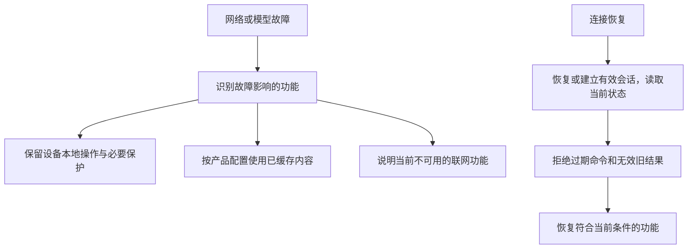

# 怎样平衡成本、离线能力和可靠性

类型：产品取舍与计算教程。场景是低成本联网玩具，也适用于其他设备。数字示例均为教学假设，实际采购、部署和支持事实分别见[硬件方案](../../19-硬件选型采购与BOM.md)、[架构](../../03-总体技术架构.md)、[设备证据](../../30-设备支持矩阵与证据台账.md)。

## 1. 不只计算芯片的钱

| 成本 | 典型组成 | 容易漏掉什么 |
| --- | --- | --- |
| 单台硬件与制造 | 控制芯片、内存、音频、电源、电池、外壳、装配、测试 | 峰值供电、声学、损耗和返修 |
| 配套硬件 | 路由器、家庭网关、可选模型主机 | 用户已有设备与必须新购设备要分开 |
| 软件与交付 | 固件、应用、驱动、升级、内容与验证 | 音频调试和长期维护 |
| 运行费用 | 识别、模型、合成、带宽、存储和服务运维 | 对话越多不一定越赚钱 |

开发板适合实验，量产则要评估稳定料号、PCB、电源、射频、制造和验证。不能只把开发板单价乘数量就当成成品成本。

## 2. 一个共享 AI 费用的计算例子

可以先把语音识别、语言模型和语音合成的真实用量，折算成目标场景下的“每分钟有效成本”，再作初步估算：

```text
月度 AI 费用估算
= 设备数量 × 每日活跃比例 × 活跃设备日均对话分钟
  × 当月天数 × 全链路每分钟有效成本
```

纯教学假设：1,000 台设备，每天 30% 活跃，活跃设备平均每天对话 10 分钟，每月按 30 天、每分钟 0.10 元计算，则为 9,000 元/月，平均到全部设备是 9 元/台/月。

0.10 元不是提供方报价。真实服务可能按音频时长、字符、token 或不同输入输出分别计费；还应计算失败重试、闲置实例、带宽和运维，并用实际账单校准估算。

注册设备数不等于同时对话数。瞬时并发和每轮耗时决定服务排队；并发增加时，费用和时延要一起评估。

## 3. 三种部署取舍

| 方式 | 好处 | 代价与边界 | 与本项目的关系 |
| --- | --- | --- | --- |
| 设备＋共享网关＋云模型 | 终端轻量，本地规则与云对话分工 | 需要网关；模型受互联网影响且有持续费用 | 当前目标架构允许的组合，模型链按进度实现 |
| 设备＋共享网关＋本地模型 | 可减少媒体外发和公网依赖 | 需要足够算力与运维；速度要实测 | 当前目标架构允许的组合，不能保证任意NAS都能流畅运行 |
| 设备直接连接云服务 | 用户可能不需额外家庭网关 | 新增云接入、身份、媒体和故障恢复设计 | 产品候选路线，不是现有MVP接入方式 |

让普通用户额外购买一台网关，会影响整套玩具的价格；复用已有常在线主机则是另一种成本条件。方案比较时必须把这个前提写清楚。

## 4. 离线有不同含义

| 故障 | 仍可能继续的功能 | 会受到影响的功能 |
| --- | --- | --- |
| 互联网中断，家中网络正常 | 已实现并部署的本地规则、设备本地操作 | 远程访问、云模型与云内容 |
| 模型服务不可用 | 固定规则、本地提示与获准缓存内容 | 新的开放式对话或生成 |
| 家中网关停机 | 设备自身按键、固件中的本地功能和保护 | 依赖该网关的跨设备联动与管理 |
| 玩具与网络断开 | 设备已有的本地功能 | 新的联网任务和实时媒体 |

具体能继续什么，要写进产品功能与验收条件。家庭没有互联网、家庭局域网也消失、网关故障，是三个不同实验。



<details>
<summary>查看图形源码（Mermaid）</summary>



</details>

读图：恢复连接不等于补做之前所有操作。孩子已经按下停止，旧故事的音频就不应在重连后突然响起。

## 5. 三个会影响体验的可靠性原则

**动作在哪里执行，必要保护就在哪里落实。** 电机过热、限位和停止不能依赖云端自然语言判断。语言模型只提出受限的高层意图。

**重试前先查原操作。** 应用没收到响应，不能断言设备没执行。使用原操作编号查询，可以减少重复发命令造成的重复动作。

**模型故障应与设备控制隔离。** 模型占满内存或迟迟不返回时，本地控制应按明确边界工作；实现需要资源限制和故障验证。

## 6. 基础安全也是产品功能

设备要能证明自己是谁，应用要确认谁有权控制，固件更新要检查来源与适配型号。玩具上传声音时，应明确何时采集、谁能访问、保存多久，以及怎样停止与删除。长期记忆和模型提供方切换也需要明确的数据政策。

深入阅读：[身份安全](../../12-身份认证与安全体系.md)、[OTA升级](../../13-OTA与制品交付规范.md)、[可靠性与测量](../../28-可观测性与可靠性.md)。

自测：为了防止云端重试费，把所有超时请求都立即重发是否合理？参考答案：超时可能只是响应丢失，原调用仍在执行；需要先按提供方合同核对原操作，再决定恢复或重试。
