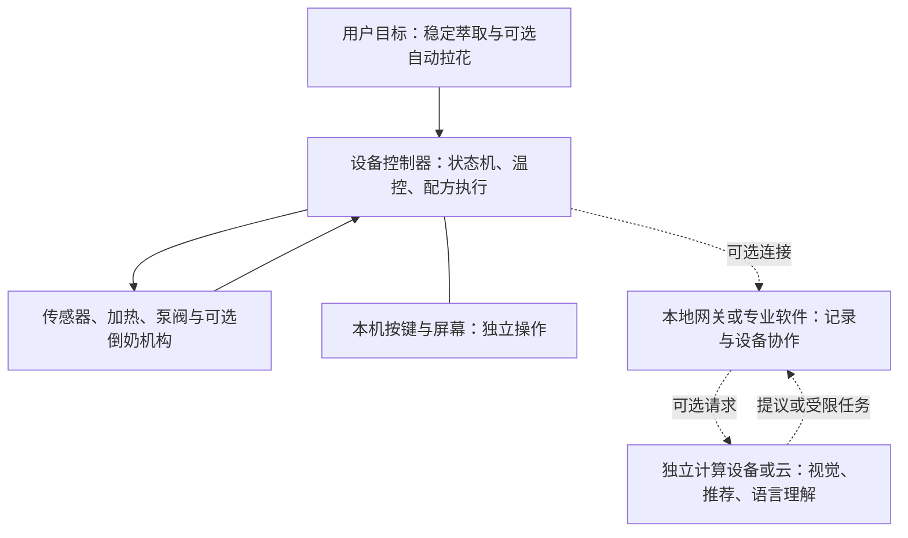

# 需求分层与联网边界

产品的工艺、自动化、交互、联网与管理目标属于不同能力层次，应分别定义需求、实现边界和验收指标。

## 能力定义与职责边界

| 层次 | 通俗解释 | 咖啡机中的例子 | 是否必须联网 |
| --- | --- | --- | --- |
| 电子控制 | 程序根据输入控制输出 | 读温度、控制加热器和泵 | 否 |
| 自动化 | 按条件和步骤完成任务 | 达温后允许萃取，按曲线运行并按条件结束 | 否 |
| AI | 识别、预测、推荐或理解表达 | 识别杯子、推荐配方、理解口语 | 否；看模型放在哪里 |
| 联网 | 与别的设备或服务交换信息 | 手机查看历史，下载配方 | 需要某种连接，但未必上互联网 |
| 平台集成 | 多种设备采用统一管理与协作方式 | 磨豆机、电子秤、咖啡机和环境设备协作 | 取决于平台部署和任务 |

PID 是根据“目标值与实际值的差”持续调整输出的一类控制算法；状态机是“预热、就绪、萃取、清洁、故障”等状态及切换规则。两者通常不需要大模型。控制稳定也不等于口味一定好：咖啡豆、研磨、粉量、布粉和水质仍会影响结果。

MCU（微控制器）本身就包含 CPU，通常还带少量内存、定时器和设备接口。所谓低成本设备“没有 CPU”，更准确地说是没有电脑级处理器和 GPU。许多温控、称重、按键和配方执行任务可在 MCU 上完成；是否够用仍需测量运算时间、内存和外设需求。[S1、S2]

## 计算资源与控制职责分配

查看 Mermaid 源码

以上为工程分工示意。视觉模型可运行在额外的本地计算设备上，不要求每块控制板都有 GPU；云也可以完全不参与。执行机构的快速控制和机器保护仍由设备控制器负责。

## 长尾场景与联网需求

[长尾机会地图](../../04-场景案例/03-长尾场景机会地图.md)中的条目是需求候选，不能直接当作“联网是刚需”或“用户愿意付费”的证据。

| 需求例子 | 首先需要什么 | 联网的增量价值 | 可以不联网的情况 |
| --- | --- | --- | --- |
| 咖啡温控更稳 | 传感、控制和热设计 | 记录与远程诊断 | 单人操作、现场看屏幕即可 |
| 自动倒奶拉花 | 奶泡工艺、机构和运动控制 | 配方分发、运营记录 | 单机重复固定动作 |
| 水族箱恒温 | 本地传感与执行 | 不在家时报警、趋势记录 | 人在现场，独立控制已满足需求 |
| 模型铁路联动 | 本地控制总线与时序 | 多终端配置、场景编排 | 单个控制台已足够 |
| 多门店设备维护 | 设备状态、维护流程 | 汇总故障、远程服务和权限管理 | 只有一台且无维护团队 |

联网价值应根据离线产品的已有能力、联网带来的新增收益，以及配置、维护、隐私和持续服务成本共同评估。离线硬件、专用软件与配件也可以构成长尾业务。

## 连接不等于互联网

- 蓝牙可以连接手机；它本身不意味着设备连接云。
- Wi-Fi 可以只用于局域网内的网页或 MQTT 消息。
- 互联网让异地访问和云服务成为可能，也增加服务依赖。
- USB、串口等有线接口也能用于本地采集与集成；需要机型真实提供接口和协议。

对咖啡机而言，优先确认物理任务能否可靠完成，再判断记录、协作或远程维护的价值。对智能玩具等语言交互设备，模型部署和流式响应更关键，参见[低成本智能玩具](../../04-场景案例/01-低成本智能玩具.md)。

来源与边界：S1 为厂商系统设计资料，S2 为具体改装项目；本页的分层、机会判断与分工图为工程解释，不是对某一具体设备的鉴定。
