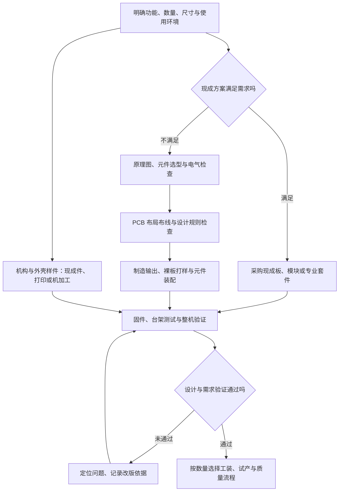

# 控制板 PCB 与制造路线

控制电路可通过成熟板卡、供应商设计、委托开发或自主研发取得。量产路线取决于功能差异、结构、供应链、制造测试和维护责任，不能仅按研发初期的采购价格选择。

## 控制板功能与系统接口

传感器把温度、压力、液位等转成信号；控制器读取信号，运行程序；驱动电路把控制信号变成泵、阀、加热器或电机所需的动作。电源、屏幕、按键和通信模块也可能在板上。[S1]

它可能是整机主控板、温控改装板、运动控制板、界面板或联网扩展板。截图中的走线与布局，不能单独说明它承担哪一项。

## 六条硬件路线

| 路线 | 自己画板？ | 合适的起点 | 主要限制 |
| --- | --- | --- | --- |
| 采用成品机已有公开接口 | 通常不需要 | 状态读取、历史采集、受支持的操作 | 接口、许可、固件版本和售后边界 |
| 外围独立传感 | 通常不需要 | 电子秤、外置温度或使用次数记录 | 未必准确代表机器内部状态，也不自然获得控制能力 |
| 开发板＋现成模块 | 不必立即画专板 | 台架原理验证、低压模拟 | 接线、空间、连接可靠性和批量一致性 |
| 现成改装控制板或套件 | 不需要自己设计 | 对兼容机型增加专业控制 | 仍需专业安装、校准与兼容检查 |
| 定制载板或整块控制板 | 需要设计，可委托 | 空间、连接器、成本或批量要求明确 | 设计验证、改版、制造与生命周期维护 |
| OEM/ODM 合作 | 可由合作方负责 | 借用成熟整机、模块与供应链 | 起订量、知识产权、固件控制权和服务责任 |

OEM/ODM 的具体分工以合同为准，不同供应商对术语的使用并不完全一致。委托制造不等于转移了产品全部责任。

Gaggiuino 官方资料同时列出 PCB 路线、Component（Lego）元件组合路线和认可的 PCB/套件供应商，是“不必从零自己画板”的具体例子。它有机型兼容限制，不是任意咖啡机通用改装方案，也不代表自动倒奶拉花。[S2]

## 设计、制造与装配分工

| 名称 | 实际在做什么 | 得到什么 |
| --- | --- | --- |
| 原理图 | 定义元件以及电气连接 | 电路逻辑设计 |
| PCB 布局布线 | 定义元件位置、铜线与板框 | 板子的制造设计 |
| PCB 打样 | 按制造文件做少量裸电路板 | 尚未装齐电子元件的板 |
| PCBA | 将元件装配到 PCB，常包含贴片和焊接 | 装配后的电路板 |
| 固件 | 编写并烧录控制器运行的程序 | 传感、控制、界面和通信行为 |
| 机构与外壳设计 | 设计支架、运动结构、热水管路和外观 | 图纸、样件与装配方案 |
| 开模 | 为特定制造工艺制作模具，例如注塑外壳 | 用于重复制造零件的工装 |
| 整机制造与测试 | 装配电路、机构、流体和外壳并检验 | 可交付产品 |

PCB 设计不是设计 CPU 芯片。画板也不等于塑料外壳开模：原型外壳可以用现成盒、3D 打印或机加工；注塑量产才可能需要相应模具。反过来，自己设计外壳也可以配现成控制板。

查看 Mermaid 源码

图中的改版是产品开发活动，不表示在一次研究任务中无限尝试。文档研究只记录验证计划，不代替整机工程验证。

KiCad 官方教程展示了原理图、PCB、ERC/DRC 检查以及 Gerber 和钻孔制造输出。ERC/DRC 是电气及布局规则检查，能找出部分连接、间距和短路问题；通过检查不代表热设计、电磁兼容、电气安全、压力系统和整机可靠性已经合格。[S3]

## 定制控制板的量产取舍

现成模块接线太多、体积放不下、连接器容易松动、器件成本不合适或测试装配效率太低时，专板可能有价值。量产还需考虑可采购性、散热、隔离、抗干扰、装配与测试接口、序列号、可维修性和替代料验证。

比较时可以用：`专板一次性开发与验证投入 ÷ 每台实际净节省 ≈ 成本回收数量`。净节省要扣除新增测试、良率损失和售后成本；这只是估算模型，本专题没有供应商报价，不能据此给出具体回本数量。

咖啡机涉及市电、热水、蒸汽与压力。开发板能跑程序不等于可装进整机交付；电气、机械、热与食品接触部分需由对应专业人员验证。本专题解释路线，不提供市电改线步骤。
