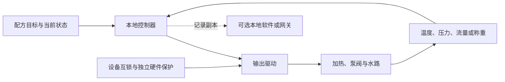

# 萃取、奶泡与自动拉花

“专业咖啡机”可能指稳定的温压控制，也可能指自动磨粉、打奶或整套机器人。先拆开动作，才能知道要加什么硬件。

## 从一杯浓缩到拉花

| 环节 | 要控制什么 | 可能需要的部件 | 网络能增加什么 |
| --- | --- | --- | --- |
| 磨粉、定量、布粉和压粉 | 粗细、粉量、均匀性与压实 | 磨豆机、称重、分配和压粉机构；也可人工完成 | 配方与记录，不能代替缺少的机构 |
| 萃取 | 水温、流量或压力过程、饮品量与结束条件 | 加热系统、泵阀、传感和本地控制器 | 历史曲线、配方共享、维护分析 |
| 打奶泡 | 温度、进气、流动与奶泡质地 | 蒸汽或其他发泡系统及相应控制 | 奶种配置、工艺记录 |
| 自由倾倒拉花 | 奶缸与杯的相对运动、倾角、流量和时机 | 人的手，或专用机构/机器人与控制器 | 动作配方分发、任务管理和结果记录 |
| 表面图案打印 | 在已有表面沉积图案 | 相应打印机构和合适介质 | 上传图片、排队和内容管理 |

最后一种可以产生图案，但与倒奶形成心形、郁金香等流体图案是不同工艺。说“自动拉花”时应明确是哪一种。

## 萃取控制闭环

控制器读取温度、压力、流量或称重数据，根据目标、曲线与状态决定输出，再继续测量。不是每种机器都有全部传感器，也不是同时独立控制压力与流量就一定可行：泵、水路和粉饼阻力会互相影响。

查看 Mermaid 源码

控制闭环是工程原理示意。独立硬件保护的具体设计需按机型确定；不能把软件状态判断当作全部保护。网络记录是旁路，不应成为闭环必须等待的环节。

Gaggiuino 提供专业控制、配方与遥测的公开案例；本专题未对其实际控制性能做测试。[S2、S6、S7]

## 奶泡制备与自由倾倒成形

Breville Oracle Jet 的 Auto MilQ 官方教程说明可以根据奶种调整温度与质地，使用蒸汽棒制作适合拉花的细腻奶泡。页面支持的是自动奶泡功能，不能据此推出机器会自己移动奶缸完成倒奶图案。[S4]

自由倾倒时，奶泡状态、咖啡表面、杯型、奶缸嘴、出奶流量、高度和运动共同影响图案。为了自动执行，需要把人的动作转成可重复的机械过程：定位杯子与奶缸，建立适当高度和倾角，控制注入与摆动，最后收尾。具体动作与参数需要咖啡工艺实验，不能照抄一个通用数值。

## 自动倒奶的机构与算法路线

不一定。可比较这些工程路线：

| 路线 | 优点 | 代价或限制 |
| --- | --- | --- |
| 固定杯位、固定奶缸的专用机构 | 可针对有限杯型和图案简化结构 | 柔性较低，仍需精准控制倒奶和清洁 |
| 多轴运动平台或机械臂 | 可改变姿态并覆盖更多动作 | 占地、成本、标定、运动安全和维护更复杂 |
| 增加视觉与其他反馈 | 帮助处理杯位、液面或状态变化 | 相机、光照、数据和算法也需验证 |
| 示教、轨迹复现或学习方法 | 可吸收专业人员经验 | 复现演示不代表面对不同奶泡与杯型仍然成功 |

Artly 官方展示机器人磨粉、压粉、蒸奶和拉花，并介绍动作采集、学习与反馈技术。这证明存在完整机器人产品路线的公开案例；厂商的精度、销量或“冠军级”宣传不是本专题独立实测结论。也不能推出所有自动拉花都需要视觉语言动作模型。[S5]

AI 可用于建议参数、分析结果或处理变化；稳定的专用设备也可以使用预设动作与传统控制。若视觉计算较重，可用单独的本地计算设备，运动控制器继续执行轨迹。开发时用 AI 辅助写程序，与机器运行时使用 AI 是两种不同选择。

## 重复性、运营与维护约束

- 同一图案连续完成多少次，换杯、换奶、换温度后是否仍成功。
- 杯子、奶缸和工具的定位误差，以及取放、碰撞和溢出处理。
- 牛奶储存、食品接触部件、残奶、自动清洗和清洗是否有效。
- 萃取与打奶如何衔接，等待造成的奶泡和咖啡状态变化。
- 每杯耗材、失败重做、人员补料、日常维护和停机时间。

这些是工程与产品验收维度，本次没有目标产品的实测数据。是否“专业”，要同时看饮品效果、重复性、操作流程和维护负担。进入商业量产时，还要满足[工程化管理与放行条件](08-量产路线/06-工程化量产管理.md)。
