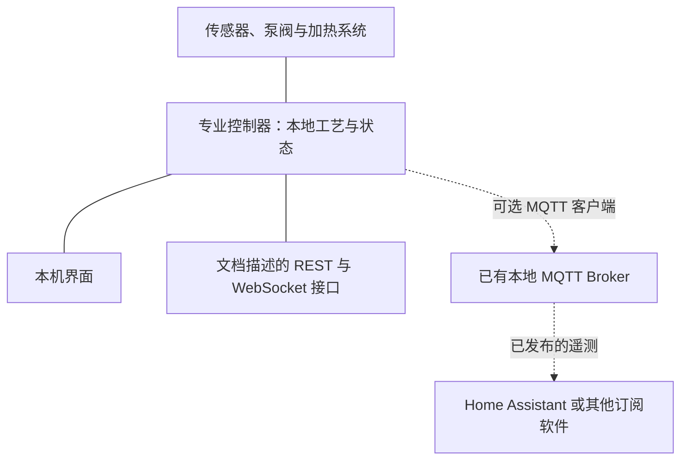
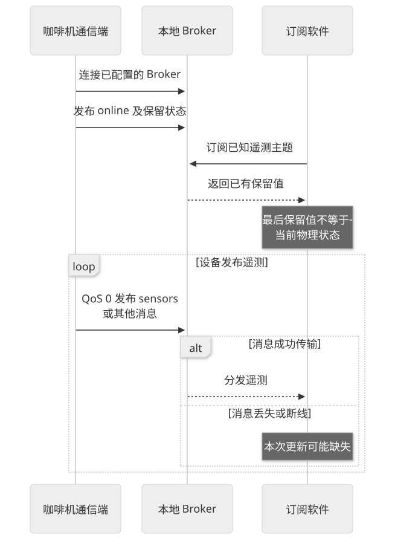
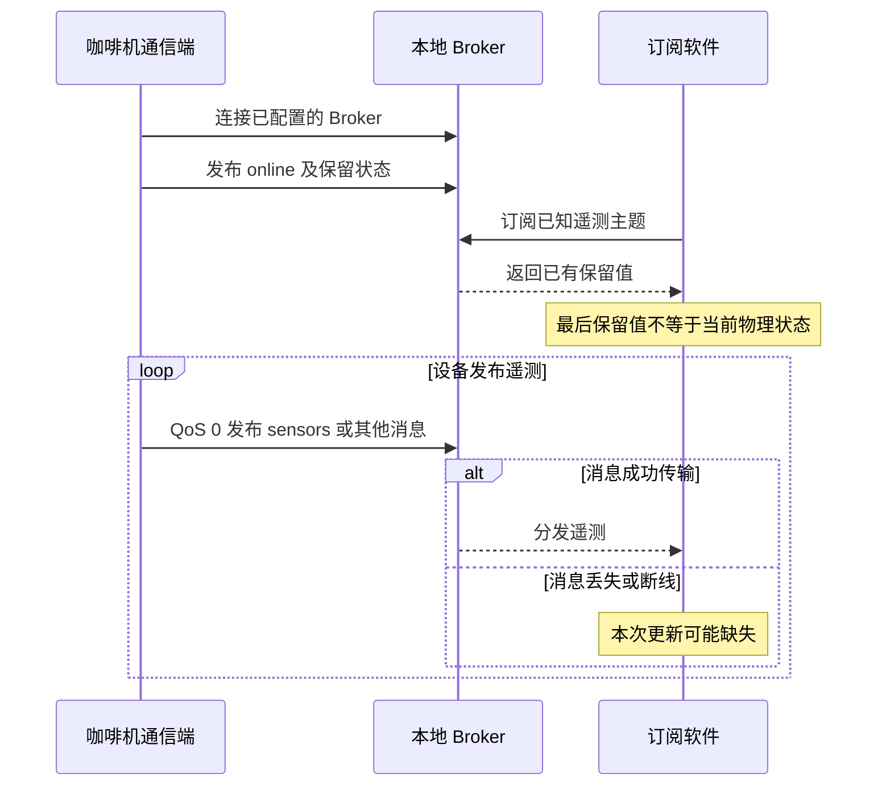

# 控制时延与可选联网

专业控制、界面交互和网络遥测具有不同时间要求。咖啡机应由本地控制器执行已验证的工艺与保护；联网采集不能代替内部控制，也不能把网络状态当作物理结果。

本页采用 Gaggiuino 官方文档作为公开案例，解释已描述的通信方式；未接实机，不代表目标量产产品采用该方案，也不引入 LimeIoT 架构。

## 公开案例的职责与连接

查看 Mermaid 源码

S6、S7 描述了 REST、WebSocket 和 MQTT 并存，以及设备作为客户端连接已有 Broker；本图将设备内部实现简化为一个专业控制边界。它不是内部电路或软件进程结构图。

## 已核实的接口语义

| 数据或机制 | 文档依据 | 解释限制 |
| --- | --- | --- |
| 状态与故障 | `GET /api/system/status`；MQTT `sensors`、`system` | 按实际板型、固件、传感与估算语义解释 |
| 萃取记录 | `GET /api/shots/latest` 与历史接口；MQTT `shot` | 数据记录不等于启动萃取的接口 |
| 配方 | 读取接口；MQTT `profile/active` | 配方目标值与实测值分开 |
| 维护记录 | `GET /api/maintenance`；MQTT `maintenance` | 文档时间为 epoch 秒，0 有特殊含义；计数有规则 |
| 遥测频率 | MQTT `sensors` 限制 1 Hz，`shot` 为另一条采样流 | 不能据 1 Hz 推断内部控制环周期 |
| 消息可靠性 | 文档声明 MQTT 发布与命令订阅使用 QoS 0 | 不保证送达，不能假设存在命令结果保障 |
| 保留消息 | 多个状态主题使用 retained | 新订阅者可能先收到最后保留值，不能证明此刻状态 |
| 现有生态 | 文档描述 Home Assistant 自动发现 | 文档存在不等于本次已测试兼容，更不代表 LimeIoT 适配 |

`boilerOn` 等字段被文档明确解释为控制输出，没有相应硬件反馈，不能当作物理动作成功的证明。`livePowerWatts` 等有估算语义，不当作外置电表实测。[S7]

REST 设置示例含服务 token 与 MQTT 凭证字段，MQTT 设置文档则声明移除了特定凭证。使用接口时应控制字段与访问范围，不能整份复制到模型或云端。[S6、S7]

## 遥测采集时序

查看 Mermaid 源码

本图解释官方文档中的 MQTT 发布、订阅与保留语义，不是本次网络抓包。内部控制周期、网络抖动和实际延迟尚未测量。

## 时延分解与测量边界

交互总时延可分为输入、解析、传输、设备受理、物理准备与执行、结果显示。预热、加压、打奶和机械运动属于物理过程，不能把它们都归为网络卡顿。

对快速控制，传感采样、控制计算、输出与保护在本地按实际设计执行；是否满足稳定性和截止时间，需用相应控制与实时性测试证明。网络用于已支持的数据或操作，不应成为设备每次温控或运动都要等待的环节。

测量至少分别记录内部控制周期/抖动、界面响应、遥测更新年龄、请求受理及任务完成时间。使用 p50/p95 等统计值时同时记录样本数、固件、网络与负载条件；当前没有实机数值，不给保证时延。

## 故障责任边界

| 情况 | 工程处理原则 | 证据要求 |
| --- | --- | --- |
| 网络或软件失效 | 本地专业控制与保护按设备设计处理，不以远程消息代替保护 | 对应机型的故障测试 |
| 遥测过旧 | 显示最后接收时间与可知的新鲜度，避免把旧值当执行条件 | 时间基准及断线记录 |
| 操作结果未确认 | 记录未知状态，先获得设备事实，不盲目重发物理动作 | 实际接口语义和设备状态 |
| 传感异常、泄漏或机构故障 | 依赖设备本地故障策略、机械与电气保护 | 异常工况和整机验证 |

这些原则是工程建议，不能冒充 Gaggiuino 或目标产品已经通过的验收结果。智能插座只能控制供电，不能提供任意咖啡机的水位、杯位、压力、清洁或自动出杯能力。

公开来源见[资料台账](07-资料来源与待核验问题.md)。
