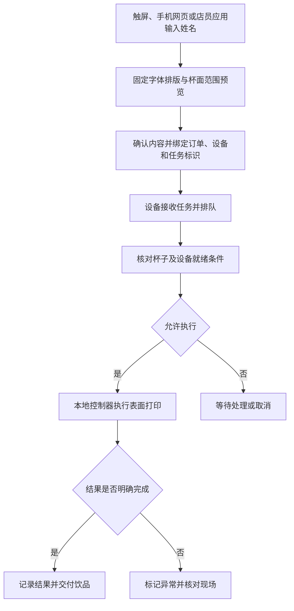

# 姓名与图案定制交互

姓名定制可以通过设备触屏、顾客扫码网页或店员应用完成，无需顾客操作命令行。输入姓名只是内容来源，设备最终能否生成清晰文字，取决于成形工艺、字形、可用面积和设备接口。此功能本身不要求 AI、互联网或 LimeIoT。

本章区分已经查到的产品资料与建议的产品设计。S12–S14 是 Ripples 官方支持文档；下述“林晓”示例、任务状态和量产验收项目是工程设计参考，未在目标设备或 LimeIoT 上实现和实测。

本机触屏所需的操作系统、显示驱动、中文输入与资源配置，见[设备系统与显示](../09-设备系统与显示/README.md)。

## 1. 普通用户的输入入口

“终端”既可以指顾客面前的触摸屏，也可以指开发者使用的命令行。面向顾客的产品通常采用图形界面；命令行适合开发、诊断或产线维护。

| 入口 | 使用流程 | 设备和连接条件 | 工程取舍 |
| --- | --- | --- | --- |
| 设备触摸屏 | 输入姓名、选择样式、预览、确认 | 设备具备文本输入与排版能力；可完全本地运行 | 增加显示、输入法和界面维护成本；公共设备需及时清理上一位内容 |
| 顾客扫码网页 | 手机打开页面，输入姓名并提交 | 手机与任务服务建立连接；可采用互联网，也可另行设计本地网络方案 | 不增加姓名输入专用屏幕；需正确绑定门店、设备和订单 |
| 店员应用或收银系统 | 店员在订单上填写姓名，选择目标打印设备 | 收银系统与设备有受支持的接口或本地连接 | 便于与订单绑定；需处理授权、版本兼容和队列 |

扫码只是打开一个地址的入口，不等于必须上云，也不等于页面已验证顾客身份。小程序同样是可选入口；其账号、平台和联网条件需要另行评估。

## 2. 已查证的商业产品交互

| 来源 | 官方正文支持的事实 | 证据边界 |
| --- | --- | --- |
| S12：The Ripples App | 手机 App 可以添加、管理自定义饮品图案，向设备和 WebApp 提供内容 | 未据此确认任意中文姓名文本输入、第三方 API 或离线运行能力 |
| S13：The Ripples WebApp | 顾客可用 WebApp 与设备交互；正文列出实时消息与祝福语、二维码、图片和边框，并说明上传内容的队列保留时间 | 未实际扫码提交、连接设备或验证中文字体与输出质量；“实时”是厂商用语，没有时延实测 |
| S14：Web App QR Code | 官方提供 WebApp 二维码与店内展示资源 | 页面提供通用二维码，不能由此断言二维码会直接绑定某台设备或具体顾客订单 |

S13 写明内容在移动队列中最多保留一小时，打印后 30 分钟自动移除。这是该产品公开描述的队列规则，不代表本方案已经采用，也不能外推为所有后台副本均已删除。

相关链接、访问时间、短摘录和定位见[来源台账](../07-资料来源与待核验问题.md)与[证据摘录](../evidence/2026-11-02-量产资料证据摘录.md)。

## 3. 两种成形工艺的能力边界

| 功能分支 | 姓名转换过程 | 适用边界 | 分支资料 |
| --- | --- | --- | --- |
| 表面图案打印 | 文本经过字体排版，生成设备支持的图像，再由打印机构在合适饮品表面成形 | 适合评估文字、标志和照片定制；仍需验证笔画、对比度、有效范围、杯面状态和耗材适用性 | [表面图案打印](05-表面图案打印.md) |
| 真实倒奶拉花 | 目标图案需转为可实现的倒奶动作，同时控制流量、位置、姿态与液面变化 | 不是把任意字体轮廓转换成机械轨迹就能实现；任意中文姓名不能视为已有通用能力 | [自动倒奶模块与机器人](04-自动倒奶模块与机器人.md) |

对“稳定输出任意姓名”这一产品目标，优先评估表面打印路线。若限定必须由倒奶成形，应先建立可重复验证的图案集合、字形限制和工艺验收标准，再确定销售承诺。联网和大模型均不能直接消除流体成形的物理限制。

## 4. 从“林晓”到一杯成品的参考流程

以表面打印为例，建议采用以下流程。这里展示产品职责，不代表某厂商或 LimeIoT 已提供同名接口。

1. 顾客输入“林晓”，选择已支持的模板与样式。界面显示字符数和不支持的字符。
2. 排版模块用固定版本字体生成文字图像，在杯面有效区域中预览。复杂笔画不能只靠无限缩小字号解决。
3. 顾客确认内容，系统生成任务标识，绑定对应订单、设备和过期时间。设备暂时离线时明确显示未接收。
4. 店员根据订单号核对杯子与任务，放好饮品。设备检查杯位、耗材及自身就绪条件，满足条件才允许执行。
5. 设备执行已接收的图像任务并上报状态。界面分别显示“已提交”“设备已接收”“执行中”和结果；发送成功不等于成品完成。
6. 执行异常、结果不确定或断电时暂停自动重试，核对现场后决定取消或重新制作。

Mermaid 源码

图中的就绪检查是设计要求，需由具体设备传感器、控制器和操作流程实现；软件不能凭任务存在就判断杯子已放好。

## 5. 算力与时延分工

文字排版通常使用字体和图像处理即可完成，无需生成式 AI。手机、店员计算机或独立界面板可以承担排版；设备控制器只接收校验通过且符合尺寸、格式和容量限制的图像与任务信息，负责执行及本地互锁。这样可以减少在低算力控制板中实现中文输入法和完整字体系统的负担。

这仍然需要固件、内存、通信接口及图像格式适配，不能只凭“设备联网”推断支持图片任务。采购封闭设备时，官方顾客网页存在，也不代表厂商开放了可供 LimeIoT 使用的打印 API。

用户感知的总时间包含输入与预览、内容传输、排队、制备饮品、摆杯检查和物理打印。应分别测量这些阶段；云端响应变快不会缩短奶泡制备和机械动作所需时间。建议预先生成并缓存模板，提交时一次传输最终内容，将工艺动作留在设备本地执行。对于云服务失联，只有已经设计并验证本地任务通路的产品才能承诺离线定制。

## 6. 量产交互与验收

以下是目标产品需要形成的验收证据，不是本次已通过的测试。

| 维度 | 产品规则与验证证据 |
| --- | --- |
| 字体与内容 | 固定字体版本和授权；覆盖目标语言、罕见姓名、组合字符、超长文本和空输入；不支持时提交前明确提示 |
| 输出质量 | 对应具体型号、耗材、杯型与饮品状态，建立最小可辨笔画、有效区域、可读性与偏移判定，并留样或拍照 |
| 任务与杯子 | 验证多人同时提交、同名顾客、多设备、换杯、错单和订单取消；打印前核对业务标识与现场杯子 |
| 并发与过期 | 队列容量、等待时间、拒绝或取消规则明确；未执行的过期任务不能在网络恢复后突然制作 |
| 重复与故障 | 同一任务重复送达不能直接重复执行；持久化执行状态；断电或回执丢失后可能存在物理结果不确定，需核对现场，不能只靠网络重试声称绝对只执行一次 |
| 权限与内容处理 | 顾客入口不能直接操作任意设备或维护接口；限制上传大小、格式及排版资源消耗；先验证再执行 |
| 隐私与维护 | 姓名、照片、订单和诊断日志分别定义用途、访问权限及保留期限；验证换客清屏、任务过期及各存储层的清理效果 |
| 配置与追溯 | 字体、模板、图像转换器、固件和硬件版本可对应；质量缺陷可以定位到相关批次与软件配置 |

## 7. 独立产品与 LimeIoT 的关联判断

单机触屏定制或收银机通过本地连接下发任务，可以构成完整独立产品；不需要为姓名定制引入通用 IoT 平台。多门店、订单协同或远程运营可能需要应用服务，也不能直接推导出必须采用 LimeIoT。

只有明确提出设备资产管理、状态监测等通用需求，并具备合法可用的接口、适配实现及验收证据后，才进一步评估 LimeIoT 的增量价值。专业排版、饮品工艺和现场交付仍有各自的责任主体。当前专题没有这些集成证据，结论保持为独立产品分析，详见[平台关联评估](../04-独立运行与LimeIoT集成决策.md)。

回到[量产分支导航](README.md)。
