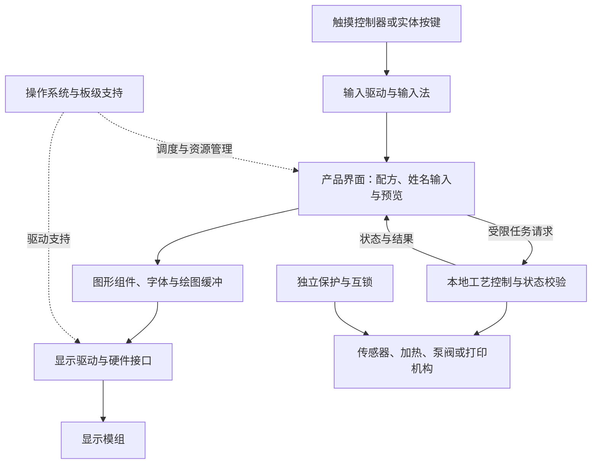

# 嵌入式操作系统与显示方案

查证日期：2026-11-02。设备可以采用 Xiaomi Vela 或 openvela 这类嵌入式系统，并提供彩色触摸界面。前提是处理器、内存、板级支持、显示与触摸驱动满足产品要求；不能把它理解成给任意控制板安装一个系统就能获得完整界面。

本组先解释通用原理，再按咖啡机的量产设计拆分三条路线。系统资料来自小米与 openvela 官方页面 S15–S17；架构、资源计算与验收要求属于工程分析，没有目标设备适配和性能实测。

## 1. Vela、openvela 与设备硬件

小米将 Xiaomi Vela 定义为基于开源实时操作系统 NuttX 的物联网嵌入式软件平台。[S15] openvela 是公开的开源项目，其文档说明内核基于 Apache NuttX，并提供图形、连接、多媒体等服务。[S16]

RTOS 指实时操作系统，提供任务调度、定时和同步等机制，适合管理设备的多个并行工作。采用 RTOS 不会自动保证控制时限或整机安全；任务优先级、中断、驱动、内存和异常处理仍需验证。

| 层次 | 咖啡机中的例子 | 负责的内容 |
| --- | --- | --- |
| 硬件 | MCU、内存、存储、电源、显示屏、触摸控制器 | 执行程序、保存数据、显示和采集输入 |
| BSP 与驱动 | 启动、时钟、显示接口、触摸、泵阀和传感器驱动 | 让系统正确操作这块具体板子；BSP 即板级支持包 |
| 操作系统 | openvela/NuttX 或其他适用系统 | 调度任务，管理资源、通信和系统服务 |
| 图形与输入组件 | LVGL、字体、图像解码、输入法 | 绘制按钮、显示中文、接收输入 |
| 产品应用 | 温度与配方页面、姓名输入、订单预览 | 定义顾客和店员实际使用的功能 |

MCU 自身包含 CPU，低成本设备也有处理器。简单界面可以由 CPU 绘制，GPU 是按画面复杂度和刷新目标评估的可选加速能力。系统组件、通信模组、屏幕和 GPU 是不同选项，不应捆绑推断。

公开 openvela 与特定 Xiaomi Vela 产品的软件配置、商业合作、闭源组件及服务资格不能直接等同。使用 openvela 不能据此声称已经接入米家、取得生态认证、可以运行 Android APK 或具备任意网页浏览能力。S15 描述的合作伙伴流程，也不能外推为每次使用开源项目都必须申请该合作。

## 2. 显示屏背后的完整链路

普通显示模组主要负责显示像素；有些集成显示控制器或内部图像存储，但不因此具备完整产品应用。智能串口屏/HMI 模组还可能自带处理器、存储和界面运行环境，属于不同采购路线。

| 部件 | 选型内容 | 不能替代的工作 |
| --- | --- | --- |
| 显示面板与模组 | 尺寸、分辨率、亮度、视角、接口、控制器、寿命 | 模组本身不自动提供咖啡机界面 |
| 显示接口与驱动 | 例如 SPI、并行 RGB 或 MIPI DSI，按芯片和模组支持选择 | 接口相同仍需核对电气、时序和驱动 |
| 触摸模组与输入驱动 | 电容/电阻触摸、控制器、坐标映射，常见通信为 I²C 或 SPI | 显示能亮不代表触摸已能使用 |
| 图形库与资源 | 控件、图片、字体、渲染缓冲和动画 | 显示中文与提供中文输入法属于不同能力 |
| 结构与整机设计 | 玻璃、密封、安装、公差、防凝露、清洁剂适应性、EMC/ESD | 开发板演示不能代替咖啡机使用环境验证 |

openvela 官方维护的 LVGL 仓库介绍了按钮、标签、键盘、中文排版、拼音输入法和触摸等能力。[S17] 这支持“可构建带中文输入的嵌入式界面”，不证明任意板卡或默认镜像已经集成这些组件。也可选择其他经过评估的图形方案。

Mermaid 源码

这是职责图。界面与工艺控制可以位于同一颗 MCU、不同处理器或不同板上，分别见下面的路线文档；图中连线不代表已实现的 API。

## 3. 显示内存与传输时间的计算

帧缓冲用于保存一幅画面的像素。以 RGB565 为例，每像素占 16 位，即 2 字节：

**完整画面字节数 = 宽度像素数 × 高度像素数 × 每像素字节数。**

| 示例分辨率 | 一个完整 RGB565 画面 | 两个完整画面缓冲 |
| --- | --- | --- |
| 320 × 240 | 153,600 字节，150 KiB | 300 KiB |
| 480 × 480 | 460,800 字节，450 KiB | 900 KiB |
| 800 × 480 | 768,000 字节，750 KiB | 1,500 KiB |

以上是算术示例，不是任何平台的最低配置或实际 RAM 占用。产品还需要操作系统、线程栈、控件、字库缓存、图片解码、网络和业务内存。不同像素格式、压缩和渲染路径会改变资源需求。

分块渲染可以降低主控侧绘图缓冲需求。例如 480 像素宽、40 行高、RGB565 的缓冲为 38,400 字节，即 37.5 KiB；是否可用取决于图形库、驱动和面板控制器。有些缓冲在显示模组内部，有些方案需要主控连续提供完整画面，不能仅靠这一公式确定整机 RAM。

带宽也会限制界面体验。假设有效像素传输速率为 40 Mbit/s，传完一幅未压缩的 800 × 480 RGB565 画面，理论最少约为 153.6 ms；实际还要计入绘制、协议和调度开销。它是传输估算，不是面板扫描刷新率或目标产品实测。局部更新、并行接口或硬件加速可能改变结果。

S16 用 32 KB RAM 的 BLE 模组到 512 MB RAM 的智能显示设备说明可裁剪范围；S17 也给出图形库的简化资源示例。这些数字不能作为“带完整中文输入、联网和动态图形的咖啡机只需几十 KB 内存”的依据。

## 4. 三条工程路线

| 路线 | 适用条件 | 主要代价与证据 | 独立文档 |
| --- | --- | --- | --- |
| 单主控 RTOS | 界面和工艺负载可控，目标 MCU 外设和资源满足要求 | 共用 CPU/RAM；必须证明界面与网络压力不影响工艺时限 | [单主控 RTOS 与轻量界面](01-单主控RTOS与轻量界面.md) |
| 独立屏控与工艺主控 | 需要独立迭代屏幕、中文交互或供应商 HMI | 增加处理器/模组、连接与协议；需验证断连、错序及版本兼容 | [独立屏控与工艺主控](02-独立屏控与工艺主控.md) |
| Linux 界面与工艺主控 | 复杂网页、较丰富的媒体或软件依赖确实要求 Linux 生态 | 增加内存、存储、启动、更新和系统维护工作 | [Linux 界面与工艺主控](03-Linux界面与工艺主控.md) |

带触屏不等于必须采用 Linux 或 Android，也不等于一定需要两块板。选择取决于已验证的硬件、负载、交付责任和总成本。Vela/openvela 是候选软件基础，不能代替量产设计。

## 5. 姓名定制与平台边界

本机输入姓名需要字符输入、字库、排版、预览、任务绑定与执行反馈。若本机输入法或字库成本过高，可采用手机输入并生成设备可接受的图像，机器保留状态与确认界面。显示图案和真实倒奶成形仍属于不同能力，见[姓名与图案定制交互](../08-量产路线/07-姓名与图案定制交互.md)。

以上三条路线均可作为独立产品设计，不以互联网、AI 或 LimeIoT 为前提。操作系统、图形界面与设备管理平台解决不同问题；当前没有咖啡机 openvela 适配或 LimeIoT 集成证据。

来源 S15–S17 见[台账](../07-资料来源与待核验问题.md)与[证据摘录](../evidence/2026-11-02-量产资料证据摘录.md)。回到[咖啡机专题](../README.md)。
