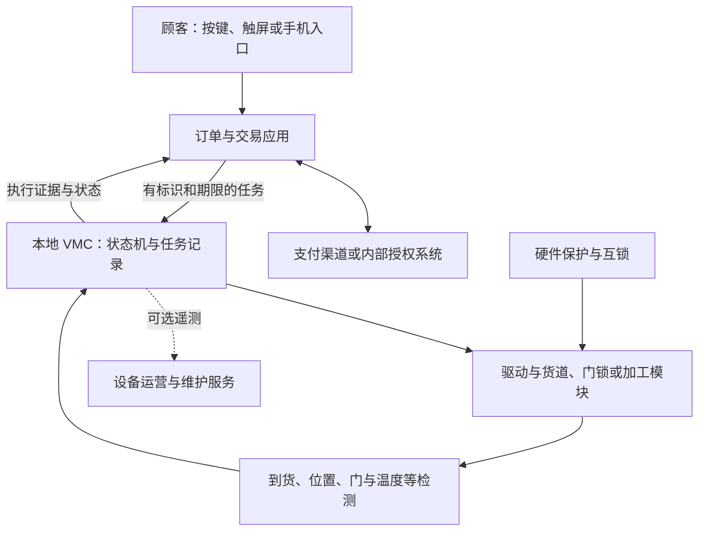

# 硬件系统与出货反馈

售货设备的硬件围绕储存、分离、移动、取货和维护形成完整路径。选择控制板前先确定商品及交付方式。以下是通用工程分层，V01 支持包装与机构验证原则，V02 支持支付外设与 VMC 的职责区分；具体电路和机构尚未选型。

## 系统组成

| 模块 | 主要职责 | 需要确定的设计条件 |
| --- | --- | --- |
| 机柜与货架 | 储存、分区、安装、防护、维修访问 | 包装尺寸、承重、点位环境、装卸与防倾倒设计 |
| 货道/格口/加工模块 | 分离单件、开门或制备商品 | 电机与传动、锁具、水路、行程、清洁及故障状态 |
| 驱动与功率板 | 将控制信号转换为负载动作 | 负载、电源、保护、EMC、热与故障关断 |
| VMC 与本地存储 | 调度机构、校验状态、保存任务与结果 | 接口、控制时限、掉电行为、寿命和版本 |
| 检测组件 | 提供位置、门、到货、温度等观测 | 安装、覆盖范围、误差、标定和传感器故障识别 |
| 界面与支付组件 | 展示商品、收集输入、取得交易授权 | 显示与输入、支付产品资格、接口及维护边界 |
| 网络/网关 | 交换订单、状态、告警和维护数据 | 链路、认证、缓存、恢复与供应商接口 |

不是每台设备都需要所有模块；无冷藏设备无需按冷藏方案设计，格口柜也不必配置螺旋推货电机。

Mermaid 源码

订单应用可位于本机、局域网或服务器，依交易方式选择。图中的模块是责任分层，不等于必须配置相同数量的处理器、板卡或云服务。

## 从动作到交付证据

| 观测 | 能够支持的判断 | 单独不能证明的结论 |
| --- | --- | --- |
| 电机收到启动命令 | 控制软件发出了意图 | 电机真正运动或商品送达 |
| 电流、编码器、限位等 | 驱动状态、位置或异常线索 | 顾客拿到正确数量、正确商品 |
| 取货区光电/称重等 | 对应检测范围内发生通过或重量变化 | 所有包装均可正确识别，或顾客已拿走 |
| 门锁与门磁 | 门锁/门的相关状态 | 格口内容正确、顾客取完、未多拿 |
| 视觉识别结果 | 模型对画面的分类或事件判断 | 没有误识别、遮挡和争议 |

应按交付分支确定“完成”的判据及证据组合，保留订单、任务、货位、软件版本和观测记录。包装或货位配置变化后重新验证。录像也不能脱离授权、保留策略和人工复核责任无限存储。

## 本地安全与维护模式

取货口、防夹、维护门、温度、负载异常和必要的独立保护由具体风险分析决定。远程运营可以提出停售或维护请求，但不应绕过本地互锁直接操作功率输出。

维护模式需明确谁可进入、可执行哪些测试、是否禁止顾客下单以及如何恢复营业。维修完成不能只清除告警，还应验证机构、传感器、库存和交易状态。

电气参数、接线和测试限值必须依据目标器件及适用标准形成设计文件。本专题未提供可直接接线的电路方案。[V06]

参见[系统与屏幕](04-屏幕系统算力与交互.md)、[制造与量产](08-制造与量产路线/README.md)。来源见[台账](12-资料来源与证据边界.md)。
