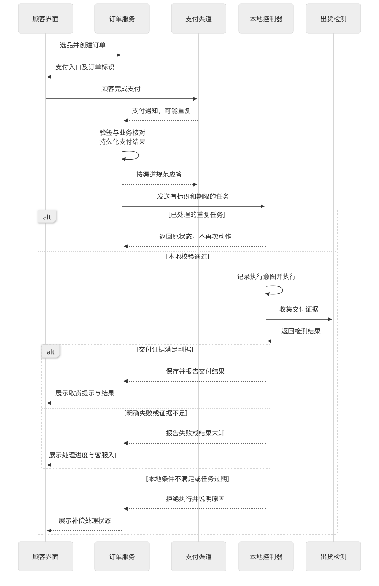
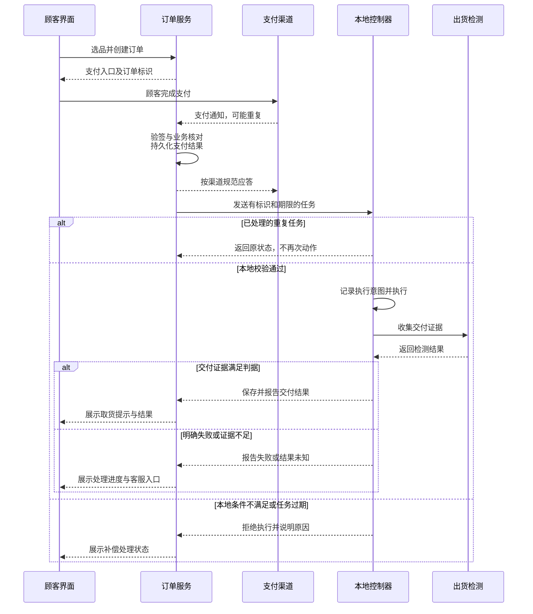

# 交易支付与出货一致性

支付状态、设备执行状态和物理交付状态分别保存并相互核对。微信支付文档明确要求回调、查单、重复通知处理和对账；退款受理也不等于退款成功。[V03、V04、V10] 以下以“选品后扫码、支付成功再交付一件商品”为参考设计，不代表所有机型或支付产品采用同一流程。

## 四类对象与稳定标识

| 对象 | 保存内容 | 关键边界 |
| --- | --- | --- |
| 业务订单 | 商品、数量、价格快照、目标设备、售卖时段和交付规则 | 修改价格不能回写已确认交易的历史价格 |
| 支付记录 | 支付渠道、商户订单标识、金额币种与渠道结果 | 前端截图、点击“我已付款”或网络应答不是可靠支付凭据 |
| 设备任务 | 任务标识、订单/订单项、设备身份与生命周期、目标货位、期限和执行记录 | 同一任务重发不应变成新的动作任务 |
| 退款/补偿记录 | 退款标识、原因、金额、关联订单与渠道结果 | 受理、处理中、完成和异常分别跟踪 |

创建支付前检查可售状态并安排库存预占/并发约束，支付确认后仍需由本地检查机器是否可执行。云端预占不保证期间没有断电、包装卡住或现场错误补货。

## 参考交易时序

Mermaid 源码

图中通知应答在机械动作前完成，避免把支付渠道的通知连接等待时间与出货时间绑定。具体应答以实际支付接口为准；V04 中的五秒是支付通知应答要求，不是机械出货时限。

## 交易条件与异常处理

支付通知需验证签名并核对商户、订单、金额、币种及当前业务状态，按实际渠道规则处理。去重与状态更新应具备并发控制；不能仅在内存里记一个“已收到”。只有可信服务才能形成设备授权，顾客页面不直接获得任意电机控制权。

| 事件 | 参考处理原则 |
| --- | --- |
| 支付通知重复或查单与通知并发 | 同一笔支付更新原记录，对同一交付义务生成稳定任务，避免重复出货 |
| 支付状态尚不明确 | 主动查单并提示处理中，不凭前端画面出货，不要求顾客反复换单支付 |
| 支付成功但任务过期、设备离线或不可售 | 按交付期限和规则取消履约或补偿，不在很久以后突然为已离开的顾客出货 |
| 明确未交付 | 按事先确定的规则发起退款或可接受的补偿，持续跟踪结果 |
| 动作发生但结果未落盘、检测矛盾 | 标记结果未知，核对设备日志与现场，不自动重转电机 |
| 部分商品交付 | 逐订单项记录数量与金额，处理部分退款，不能用整单成功掩盖漏货 |
| 退款请求超时 | 使用原退款标识查询或重试，不能每次生成新退款单；以最终结果更新顾客页面 |

退款成功不自动证明商品还在原货位。库存需要按物理事实盘点或恢复，避免将已掉落、已损坏或被取走的商品重新售卖。

## 物理动作与“恰好一次”的边界

稳定任务标识、持久化意图和结果可以减少重复执行，但在断电恰好发生于动作与结果落盘之间时，仍可能无法仅凭软件确定商品是否已经交付。恢复策略需要检测证据、设计约束和人工处理，不能把消息中间件的 QoS 或数据库事务描述成整机物理交付的绝对保证。

## 退款、授权撤销和现金找零

扫码交易常见的是支付后退款；卡支付可能存在预授权、完成或撤销；现金涉及收币、余额与找零；内部领用可能只占用额度。它们不能统一映射成“调用退款接口”。Qibixx 的授权/完成/撤销说明是具体厂商 API，不能直接替代微信退款流程。[V02、V10]

支付资质、卡终端和收单责任、渠道额度与资金对账按实际产品和市场确定。实现前还需完成故障注入和端到端测试，见[验收矩阵](13-知识覆盖与验收矩阵.md)。
