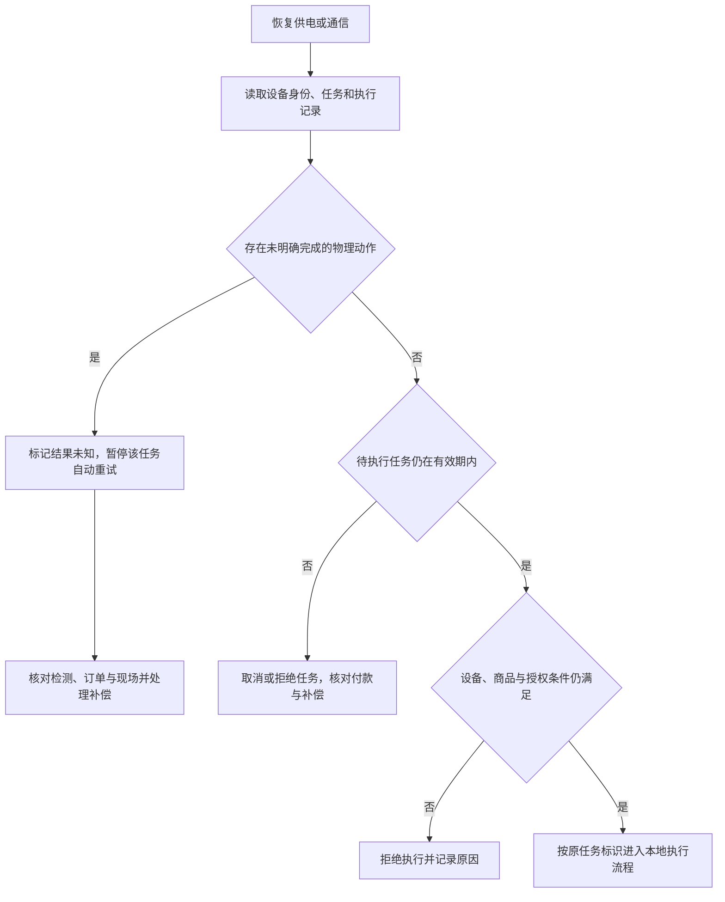

# 联网、离线与时延

机械控制可以在本地执行，联网用于交易确认、库存运营和维护协同。机器不一定需要自己的蜂窝模组，但采用线上支付时，可信订单与支付确认链路必须满足相应产品规则。顾客手机能上网不代表机器已经可靠取得授权。

## 按能力分析离线

| 能力 | 离线条件与边界 |
| --- | --- |
| 本地工艺与安全 | 根据风险设计在链路失联时继续、受控停止或拒绝新任务；不能依赖远程服务维持必要保护 |
| 现金交易 | 只有实际配置、状态机和找零条件允许时才可继续；不能因没有扫码就省略现金对账 |
| 线上扫码交易 | 未获得可信支付/订单状态时，不凭手机截图或旧结果放行；具体离线产品另行查证 |
| 卡终端 | 离线授权是否允许由终端、收单与风控规则决定，不由 VMC 自行宣称 |
| 内部员工领用 | 可在明确授权策略下评估本地额度和名单缓存，同时设计撤权过期、并发和同步冲突 |
| 运营数据 | 可设计本地有界缓存与补传，区分事件发生时间、上传时间、序号与设备重启代次 |

V09 描述的卡预授权不能直接证明国内扫码可以离线消费；V03 支持支付状态不明时查单，而不是假设成功。

## 时延组成与本地职责

顾客等待包含界面操作、下单、支付确认、任务传递、排队、本地检查、机构运动和取货。逐段记录起止点、失败结果及 P50/P95/P99 等统计口径；网络往返时间不能替代完整购买时间。

货道动作、位置反馈、防夹与其他必要互锁由本地控制承担。网络只传受限任务或结果，不将逐步电机运动放进公网闭环。缓存商品图片、复用连接和减少往返可以优化体验，但价格和可售状态仍需处理版本与有效期。

超时属于策略：支付确认超时、任务过期、交付检测超时、取货超时、退款结果超时各自处理。阈值应由支付产品、机构和点位实测决定，本专题不虚构统一毫秒指标。

## 断电与断网恢复

Mermaid 源码

换主控、恢复备份或清空任务日志可能丢失去重依据，应作为设备生命周期变更管理。过期指令、旧点位配置和旧设备身份不能在新机器上线后重新生效。

## 售后体验与运营

屏幕显示可解释的状态、订单查询入口和联系方式；退款处理中不能显示已到账。监控通信断线与“机器仍在线但货道故障”两类情况，明确远程处理与现场服务边界。

参见[交易一致性](03-交易支付与出货一致性.md)与[验收矩阵](13-知识覆盖与验收矩阵.md)。来源与事实限制见[台账](12-资料来源与证据边界.md)。
