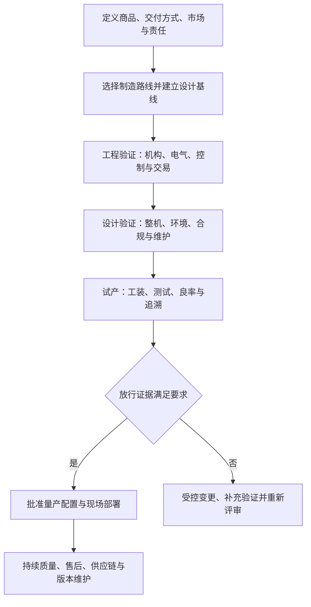

# 制造路线与工程化量产

本组面向商业交付与量产，而非只做开发板演示。选择谁负责整机设计、控制器、软件、制造和售后，再确定是否画板、开模或采购成熟平台。取得启动资金可以支持这些投入，但不能替代设计与放行证据。

## 三条制造责任路线

| 路线 | 自有主要责任 | 不自动包含的能力 | 独立资料 |
| --- | --- | --- | --- |
| 成熟整机/OEM/ODM | 定义需求、选择配置、合同、验收、品牌和运营 | 开放 API、任意定制、目标市场合规与后台永久可用 | [成熟整机与 OEM/ODM](01-成熟整机与OEM-ODM.md) |
| 定制主控＋成熟机电平台 | 负责控制/应用、接口与整机集成，复用经验证的机柜/机构等 | 原平台测试覆盖所有改动、新控制器保证原性能 | [定制主控与成熟机电平台](02-定制主控与成熟机电平台.md) |
| 整机研发＋制造协作 | 对需求、结构、控制、电气、软件与整体验证负责 | 自建工厂、所有器件自研或供应商承担最终责任 | [整机研发与制造协作](03-整机研发与制造协作.md) |

三条路线比较的是设计与交付责任，OEM/ODM 的称呼不能代替合同条款。它们均可与四类[商品交付方式](../10-交付方式分支/README.md)组合。

## 工程阶段与放行

项目可采用 EVT/DVT/PVT 等阶段名称，但名称并非统一法定验收。实际应定义每个阶段的配置、目标、记录、缺陷和批准责任。

Mermaid 源码

样机阶段证明关键原理可行，工程验证建立模块与接口能力，设计验证核对整机需求，试产验证生产与测试流程。生产放行应针对批准配置，而不是针对“之前某台样机运行过”。

## 全路线共用的工程管理

| 管理项 | 交付物与放行依据 |
| --- | --- |
| 需求与责任 | 商品、点位、环境、产能、交易、质量和服务目标；整机/业务/供应商责任矩阵 |
| 设计基线 | 图纸、原理图/PCB、线束、BOM、机构参数、固件、协议、界面/字体、支付组件与配置版本 |
| DFM/DFA/DFT | 可制造、装配与测试设计；关键尺寸、公差、连接防错、工装、测试点和质量控制计划 |
| 供应链与替代 | 器件/机构来源、供货能力、替代料验证、交期、变更通知和停产预案 |
| 产线测试 | 电气、机构、传感、门控/温控、通信、支付组件状态及必要整机测试；失败隔离与返工复测 |
| 质量指标 | 明确初次通过率、返工、不良、交付失败与现场故障的分母、条件和目标，不使用无依据统一百分比 |
| 身份与追溯 | 序列号、硬件/软件/配置、校准、批次、产线结果、密钥安全写入与换板流程 |
| 工程变更 | 变更原因、影响、批准、验证、库存/在制品处置与现场版本范围 |
| 部署与售后 | 运输、点位安装、联网、人员培训、备件、工单、数据备份、退役与服务终止 |
| 资金与库存 | 一次性研发、模具工装、测试合规、首批物料、在制/成品库存、账期、质保与服务准备金 |

纯软件的支付模拟不能覆盖出货故障，板厂测试不能覆盖机柜与商品交付，元器件合格也不能代替整机验证。更多用例见[验收矩阵](../13-知识覆盖与验收矩阵.md)。

## 中国境内食品经营的已查证要点

第 78 号令区分仅销售预包装食品的备案与需要许可的其他经营项目；自动设备还涉及点位、展示和风险管控材料。第 7 条说明省内开展已许可/备案范围业务及跨省报告，第 13、42 条分别规定相应自动设备材料，第 28 条涉及显著位置的信息展示。[V05]

实际执行要核对经营品类、主体、点位、属地实施和现行规则，不将上述概述理解为所有食品机型统一免证，亦不外推非食品设备。

## 整机标准与适用范围

IEC 60335-2-75:2024 的公开摘要涉及部分商用分配设备、自动售货机与卫生方面，也指出某些功能可能涉及制冷、微波等其他标准，同时列有工业专用等排除情形。[V06] 本专题只读其公开摘要，不给出认证或测试限值结论。

目标市场的电气、机械、EMC、无线、食品接触等适用性及必要程序，应形成具体清单并取得对应证据；不因使用低压主控或合格模组就省略整机评估。

以上管理表属于工程建议，没有目标工厂、订单、良率或放行记录。来源见[台账](../12-资料来源与证据边界.md)，返回[专题入口](../README.md)。
