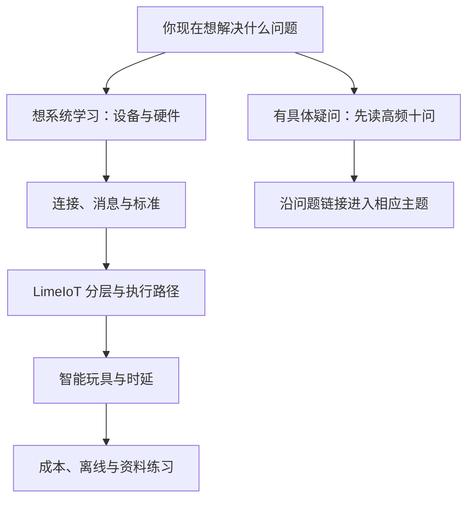

# IoT 入门知识库

面向第一次接触物联网、希望理解 LimeIoT、智能玩具及个人定制场景的读者。先从生活例子和图形认识概念，再进入工程规范。可以顺序学习，也可以直接查问题。

本知识库是教学资料，不另外维护产品需求、实时进度或型号支持事实。设计看[总体架构](../03-总体技术架构.md)，当前能力看[实施进度](../24-实施计划与进度.md)，实际设备支持看[证据台账](../30-设备支持矩阵与证据台账.md)。

## 1. 先从哪里开始

查看图形源码（Mermaid）

推荐第一次按以下顺序阅读：

1. [设备与硬件](01-基础入门/01-设备与硬件.md)：MCU、传感器、执行器、内存、供电和固件。
2. [连接协议与消息](01-基础入门/02-连接协议与消息.md)：路由器、设备网关、Wi-Fi、蓝牙、MQTT与控制反馈。
3. [LimeIoT架构导读](03-架构与方法/01-LimeIoT架构导读.md)：设备、网关、服务与客户端怎么分工。
4. [低成本智能玩具](04-场景案例/01-低成本智能玩具.md)：一次对话怎样从采音走到回答。
5. [时延与流式交互](03-架构与方法/02-时延与流式交互.md)：即时反馈、分段回答、打断和测量。
6. [成本、离线与安全](05-成本与可靠性/01-成本离线与安全.md)：硬件、云费用、断网与恢复。

想了解 LimeIoT 为什么面向小众爱好、深度玩家和定制需求，继续读[长尾场景机会地图](04-场景案例/03-长尾场景机会地图.md)（32 类、160 个候选细分需求）和[用户定制与平台能力](04-场景案例/04-用户定制与平台能力.md)。前者帮助找场景，后者解释模板、硬件、网关、专业系统与 AI 怎样分工；公开案例依据见[研究来源](06-资料与工具/03-长尾场景研究来源.md)。

## 2. 按主题找资料

| 分类 | 内容 |
| --- | --- |
| 00 高频问题 | [入门十问](00-高频问题/01-入门十问.md) |
| 01 基础入门 | [设备与硬件](01-基础入门/01-设备与硬件.md)、[连接协议与消息](01-基础入门/02-连接协议与消息.md) |
| 02 标准与生态 | [标准协议与生态边界](02-标准与生态/01-标准协议与生态边界.md) |
| 03 架构与方法 | [LimeIoT架构导读](03-架构与方法/01-LimeIoT架构导读.md)、[时延与流式交互](03-架构与方法/02-时延与流式交互.md) |
| 04 场景案例 | [低成本智能玩具](04-场景案例/01-低成本智能玩具.md)、[小米设备分类](04-场景案例/02-小米设备分类.md)、[长尾场景机会地图](04-场景案例/03-长尾场景机会地图.md)、[用户定制与平台能力](04-场景案例/04-用户定制与平台能力.md) |
| 05 成本与可靠性 | [成本离线与安全](05-成本与可靠性/01-成本离线与安全.md) |
| 06 资料与工具 | [资料索引与收集规范](06-资料与工具/01-资料索引与收集规范.md)、[术语与学习路线](06-资料与工具/02-术语与学习路线.md)、[长尾场景研究来源](06-资料与工具/03-长尾场景研究来源.md)、[资料收集模板](06-资料与工具/资料收集模板.md) |
| 07 专题研究 | [咖啡机与自动拉花](07-专题研究/01-咖啡机与自动拉花/README.md)：控制板与制造、工艺与机构、联网边界、平台关联；[Vela 与显示方案](07-专题研究/01-咖啡机与自动拉花/09-设备系统与显示/README.md) |

自动售货与内部物料领用另见[自动贩卖机专题](07-专题研究/02-自动贩卖机/README.md)，包括交易、出货、制造、运营与长尾定制。

## 3. 图应该怎样读

| 图形 | 回答什么问题 | 阅读方法 |
| --- | --- | --- |
| 架构图 | 有哪些部分，各自负责什么？ | 看分组与连接；有连接不表示所有数据都走同一路径 |
| 流程图 | 遇到条件或故障时怎么处理？ | 顺着箭头读，特别看判断分支 |
| 时序图 | 谁先做什么，谁等待谁？ | 从上往下看时间，再看箭头两端 |

图已导出为随文档保存的 SVG 图片，普通 Markdown 阅读器也能直接显示。每张图下方的折叠区保留 Mermaid 源码，方便修改；调整源码后应重新导出对应图片。图是教学简化，是否已经实现由工程进度和实际证据决定。

## 4. 怎样使用小米和 ima 的参考

[小米设备分类](04-场景案例/02-小米设备分类.md)依据使用 Computer Use 浏览的官网公开资料，先保留销售分类，再按感知、执行、媒体、任务、基础设施等职责解释。它不是 LimeIoT 的兼容名单，也没有根据商品名称补造芯片、成本或时延数据。

目录组织借鉴所提供 ima 专业知识库截图中的编号分类、高频问题与主题分层。它的具体参考范围，以及怎样收集新资料，见[资料组织方法](06-资料与工具/01-资料索引与收集规范.md)。

## 5. 学习资料与工程文档的关系

本目录帮助理解概念；[工程文档首页](../README.md)说明正式规范及各自维护范围。对当前可执行的方法，以版本化合同、已有运行说明和运行时能力为准。

本知识库不单独建设文档站；官网与网页指南的实现仍遵循[仓库边界](../21-Monorepo与开发规范.md)。
